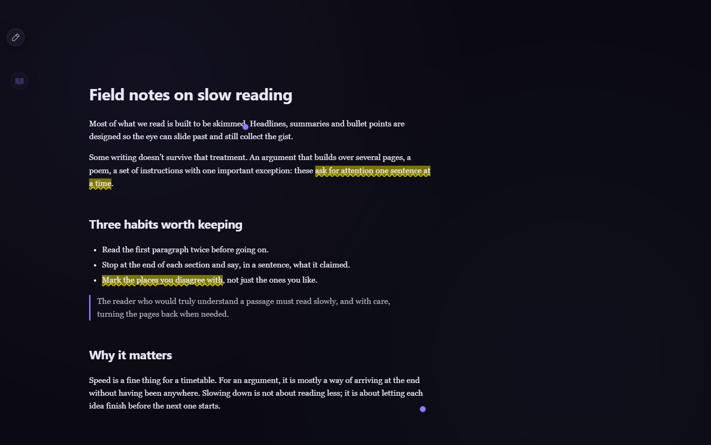
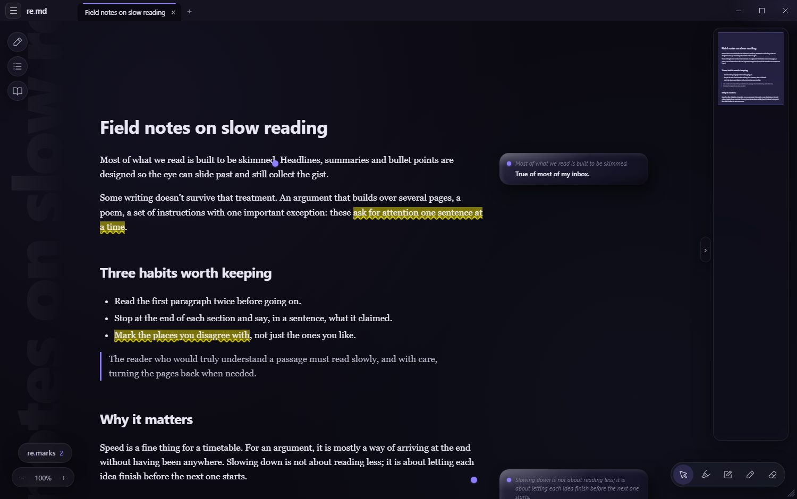
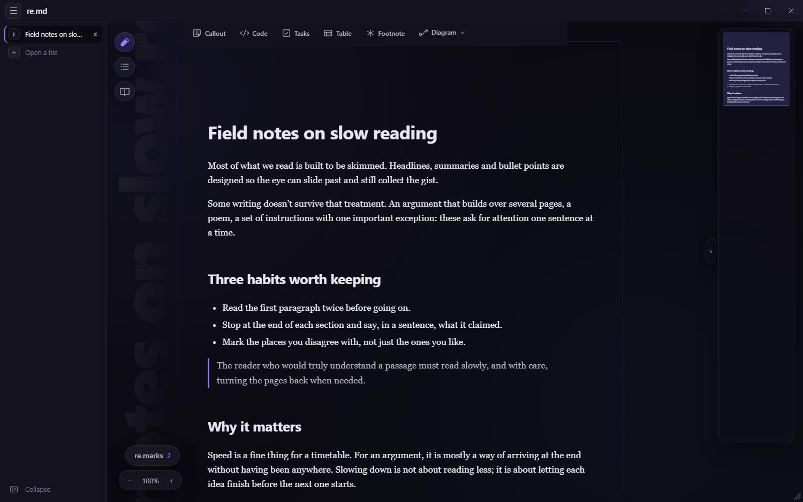

<div align="center">
  
</div>

> **A desktop reader and editor for markdown, for people who don't know what markdown is.** Read with nothing on screen but the page, highlight and write in the margins as you would on paper, then press `Ctrl+E` and edit the document itself (headings, pictures, formulas, diagrams) without ever seeing a `#` or a `*`. Your annotations are saved as a readable JSON file next to the document.

<div align="center">

| | | |
|:---:|:---:|:---:|
|  |  |  |
| <sub>**📖 Read.** Reader mode on Textured paper, with the contents beside the page.</sub> | <sub>**🖍 Mark it up.** Highlights, re.marks and margin notes.</sub> | <sub>**✍️ Write.** Edit mode, with tabs in a sidebar.</sub> |

</div>


---

## 🎉 New in 0.8.0: reader mode, and every diagram editable

- **👋 Pick how you want to use it.** First launch asks: **Reader**, **Annotator** or **Writer**. Each sets remarkdown up for you, and you can adjust it before you start. Updating to 0.8.0 starts everyone fresh: settings go back to the new defaults (your annotations and recent files stay).
- **📖 Reader mode** has nothing on screen but the page:
  - **Six page styles**, including the new **Textured** paper.
  - The contents beside the page, with minutes left.
  - **Smooth Edge-style scrolling**.
  - An ink-drying swap in and out, and grey ink that soaks in from the pointer while you rest.
- **✍️ Edit mode can make everything:**
  - A **Text style** menu for headings, lists and quotes; typing `# `, `- ` or `> ` works too.
  - Divider lines, **pictures** and **formulas**.
  - Formulas, front matter and list markers are now saved exactly as written.
  - Saving asks first instead of overwriting a file another program changed.
- **🧜 Every diagram can be changed:**
  - Click to edit flowcharts, sequence, state, class, database, pie, gantt, timeline, mind-map and board diagrams.
  - Charts such as bar & line, journey and radar edit as **tables**.
  - Everything else has a text panel with a live drawing beside it.
- **🖍 Undo for annotations** (`Ctrl+Z` / `Ctrl+Y`), tidy **arrows and brackets**, and **margin notes** out of preview.
- **🗂 Tabs on the left**, hideable tabs, right-click menus everywhere, and a new **Settings** window with a picture of what each option does.

**[Everything in 0.8.0, and every earlier release →](CHANGELOG.md)**

---

## ⬇️ Download

Installers are published with each release. Get the latest from the **[Releases page](../../releases/latest)**. Mac and Linux builds are new, so bug reports are welcome: [open an issue](../../issues) with your OS or distro and version.

### 🪟 Windows

- `remarkdown_<version>_x64-setup.exe`: NSIS installer (recommended)
- `remarkdown_<version>_x64_en-US.msi`: MSI installer for `msiexec`, Group Policy and silent installs

Already installed? **Menu → Check for updates…** fetches the next release without leaving the app. The installer registers remarkdown for `.md` and `.markdown`, and **Settings → Tabs & files** can make it your default app for them.

### 🍎 macOS (12 or later)

- `remarkdown_<version>_universal.dmg`: one download for Apple silicon and Intel Macs

Open the `.dmg` and drag remarkdown to **Applications**. The first time you open it, macOS will block it, because the app isn't signed with an Apple Developer ID yet (signing is planned). To allow it:

1. Try to open remarkdown once, and dismiss the warning.
2. Open **System Settings → Privacy & Security** and scroll down.
3. Click **Open Anyway** next to remarkdown, then confirm.

You only do this once. On macOS 15 and later, right-click → Open no longer skips the warning, so use the steps above. **Menu → Check for updates…** updates the installed app in place; the `.dmg` is only for the first install.

### 🐧 Linux

- `remarkdown_<version>_amd64.AppImage`: runs on most distros. Make it executable (`chmod +x remarkdown_*.AppImage`) and run it. On first run it adds itself to your app launcher (`~/.local/share/applications/remarkdown-appimage.desktop`). It never makes itself your default app.
- `remarkdown-<version>-1.x86_64.rpm`: for Fedora and other rpm distros. Install with `sudo dnf install ./remarkdown-*.rpm`. It registers remarkdown for `text/markdown` files.

The AppImage needs FUSE 2: on Fedora `sudo dnf install fuse-libs`, on Arch `sudo pacman -S fuse2`. Both the AppImage and the rpm update in place from **Menu → Check for updates…**. On tiling desktops such as Hyprland, remarkdown hides its own window buttons; on GNOME they show.

---

## ✨ Why remarkdown?

When you read a spec, a paper or a book chapter written in markdown, you want to **highlight passages**, **scribble in the margins** and **leave notes**, the same way you would with a paper book or a PDF. Most markdown viewers are read-only, and most annotation tools make you convert to PDF first.

remarkdown opens plain markdown from disk and shows it as a calm, readable page you can mark up. When you want to change the document itself, it becomes an editor that looks exactly like what you were reading, with no syntax and no preview pane.

Your annotations save **beside** the source file as plain JSON. They stay with your notes, survive edits to the document where possible, and can be read by any tool, LLMs included, without the document loaded.

---

## 🎨 Features

### 📖 Reading
- **Reader mode:** nothing but the page.
  - A ~62-character column with comfortable line spacing.
  - **Esc** leaves. If something is open, Esc closes that first.
  - Annotations stay visible, read-only.
- **Six page styles:** Default, Paper, **Textured** (cream paper with grain, blue-black ink), Sepia, Night and E-ink (no motion). Diagrams, code and callouts follow the page's colours.
- **Contents beside the page** in reader mode, marking the section you're in, with the minutes left. You can switch it to a quiet line at the top.
- **Ink:**
  - Switching in or out of reader mode dries away like ink on paper.
  - **Ink from the pointer:** rest the mouse and a grey spot spreads into the page. Styles are Leak, Trail, Pen or Off.
- **Edge-style smooth scrolling.** Wheel notches and scrolling keys glide and ease to a stop, with Short, Medium or Long glide.
- **Contents popover** (`h1`–`h4`) that **glides** to a section, with an optional ink trail to the heading.
- **Minimap** in the right gutter, in reader mode too. Drag it to jump anywhere; its box always covers exactly what's on screen.
- **Rendering:**
  - **Code** in real VS Code colours (Shiki), light or dark to match the page.
  - **KaTeX** formulas.
  - **Mermaid** diagrams.
  - **Obsidian-style callouts** (`> [!note]`, foldable `[!tip]-`).
  - Task lists, GFM tables, footnotes and pictures.
  - **Document details** (front matter), folded away.
- **Reading progress** remembered per file, **zoom** (`Ctrl +` / `Ctrl -` / `Ctrl 0`), dark or light UI, and a faint file-name watermark down the left margin.
- **File watcher:** edit the file in another program and remarkdown reloads within about a second, keeping annotations anchored.

### ✍️ Editing
- **`Ctrl+E`** (or the pencil) turns the page into a live editor that looks like what you were reading. Toggle back and your annotations re-anchor onto the edited text.
- **Text style menu:**
  - Normal text, Heading 1–3, Bulleted list, Numbered list, Quote and Divider line.
  - Shortcuts `Ctrl+Alt+0`–`3` and `Ctrl+Shift+7` / `8` / `9`.
  - Typing `# `, `- `, `1. `, `> ` or `---` at the start of a line does the same.
- **Toolbar inserts:** callouts, code blocks (live highlighting, language picker), task lists, tables, footnotes, **pictures**, **formulas** and **diagrams**.
  - **Pictures** link relative to the document, and you can describe one for people who can't see it.
  - **Formulas** draw as you edit and open with a live preview.
- **Tables:** type in cells, and add or remove rows and columns from a small menu. The saved markdown is neatly aligned.
- **Bubble menu** on a selection: bold, italic, strikethrough, ~sub~ and ^super^ (`Ctrl+B`, `Ctrl+I`, `Ctrl+,`, `Ctrl+.`).
- **Saved exactly as written.**
  - Formulas, front matter, list markers and every diagram line you didn't touch come back byte for byte.
  - Autosave is atomic and debounced.
  - If another program changed the file, saving stops and asks: keep yours, use theirs, or save yours as a copy.

### 🧜 Diagrams
- **Click a part, change it in plain words.** You never need to write diagram syntax, and an edit changes only the lines it's about.
  - **Flowchart:** 14 shapes, groups, colours, line styles.
  - **Sequence:** every arrow, blocks, activations, boxes, numbering.
  - **State**, **Class** and **Database (ER)**.
  - **Pie**, **Gantt** and **Timeline**.
  - **Mind map** and **Board (kanban)**.
- **Charts as tables:** bar & line, journey, quadrant, radar, flows (Sankey) and packet.
- **Anything else** (git graphs, C4, architecture, block, requirement) opens its text beside a live drawing. A broken diagram says what's wrong and can be fixed the same way.
- **Diagram menu** with 16 starter diagrams, shown as small drawings with plain names.

### 🖍 Annotation
- **Highlights** in 5 colours, drawn with the CSS Custom Highlight API (no DOM changes, clean overlaps). They can span paragraphs.
- **re.marks:** sticky notes pinned to a word.
  - The **re.marks panel** lists them all with 1–5 sentences of context.
  - **Margin notes** show them as cards beside the text, in windows from 1000 px wide.
- **Drawing:** freehand pen strokes anchored to the text, so they follow reflow and zoom.
  - **Tidy up shapes** (optional) turns rough circles, boxes, underlines, margin bars, **arrows** and **brackets** into clean ones.
  - A **Hand-drawn look** slider runs from clean to sketchy.
- **Undo / redo** for highlights, re.marks and drawings (`Ctrl+Z` / `Ctrl+Y`, or right-click). Each tab keeps its own history.
- **Eraser:** one click removes any annotation.
- **Robust anchoring:** W3C-style text-quote selectors re-find annotations after edits. Anything that can't be placed goes to the **orphan panel**, with a **Re-attach** button.

### 🗂 Tabs and files
- **Double-click a `.md`** and remarkdown opens that file; if it's already running, it comes to the front.
- **Tabs** keep their scroll position, edit mode and undo history.
  - Place them along the top or in a **sidebar on the left**.
  - Hide them with `Ctrl+Shift+B`.
  - They're restored on launch.
  - Files can open in a new tab, replace the current one, or open in a new window.
- **Right-click menus everywhere**, fitted to what you clicked (tabs, recent files, selected text, links, the page). Middle-click a recent file to open it in a new tab.
- **Open recent** with missing-file detection and per-document reading progress; drag and drop files onto the window.

### ⚙️ Settings and first run
- **"How do you want to use remarkdown?"** offers three starting layouts with real screenshots. You can reopen it from **Settings → About**.
- **Settings window:**
  - 41 options in seven sections, with search.
  - A small moving picture of what each option does.
  - Every change applies live.
- **Hand-drawn tutorial** whose arrows point at each control wherever your layout puts it. Press `?` to show it again.

### ⬆️ Updates and storage
- **In-app updater** with Ed25519-signed installers (a tampered installer is refused). It shows an aggregated changelog when you're several versions behind.
- **Atomic writes** for documents and annotation files; annotation saves retry with backoff and flush on close.
- **Error handling:** clear messages for a non-UTF-8 file, a damaged annotation file (backed up first), a failed write, or a very large sidecar.

---

## 🎛 Tools

| Tool | Key | What it does |
|------|-----|--------------|
| 🎯 **Cursor** | `1` | Select and copy text as usual |
| 🖍 **Highlight** | `2` | Drag across text to highlight it in the current colour |
| 📝 **re.mark** | `3` | Click a word to pin a note to it |
| ✏️ **Draw** | `4` | Draw freehand; the strokes become one drawing after a short pause |
| 🧹 **Eraser** | `0` | Click any annotation to remove it |

A colour strip appears above the tools while Highlight or Draw is active. Right-click a highlight or drawing for more.

---

## ⌨️ Keyboard shortcuts

| Shortcut | Action |
|----------|--------|
| `Ctrl+E` | Edit the document / done editing |
| `Esc` | Close what's open; leave reader mode |
| `Ctrl+Z` / `Ctrl+Y` | Undo / redo (annotations outside the editor, text inside it) |
| `Ctrl+O` | Open a file |
| `Ctrl+Tab` / `Ctrl+Shift+Tab` | Next / previous tab |
| `Ctrl+W` | Close the tab |
| `Ctrl+Shift+B` | Show / hide the tabs |
| `Ctrl +` / `Ctrl -` / `Ctrl 0` | Zoom in / out / reset |
| `1` `2` `3` `4` `0` | Cursor / Highlight / re.mark / Draw / Eraser |
| `?` | Show or hide the tutorial |
| **In the editor** | |
| `Ctrl+Alt+0`–`3` | Normal text / Heading 1–3 |
| `Ctrl+Shift+8` / `7` / `9` | Bulleted list / Numbered list / Quote |
| `Ctrl+B` / `Ctrl+I` | Bold / italic |
| `Ctrl+,` / `Ctrl+.` | Subscript / superscript |

On a Mac, `⌘` replaces `Ctrl` in every shortcut above.

---

## 💡 How the sidecar works

For every markdown file `foo.md`, remarkdown writes its annotations to a sibling file, `foo.md.remarkdown.json`:

```jsonc
{
  "_comment": "remarkdown annotations for: foo.md",
  "$schema": "remarkdown/v1",
  "document": {
    "path": "foo.md",
    "sha256": "7ac1bc…",
    "lastSeenBytes": 4821
  },
  "annotations": [
    {
      "id": "01HP8XYZ…",
      "type": "highlight",
      "color": "#ffd25a",
      "anchor": {
        "text": "must read slowly, and with care",
        "prefix": "The reader who would truly understand ",
        "suffix": ", turning the pages back when needed.",
        "blockHint": "p:3"
      },
      "createdAt": "2026-04-21T14:32:00Z",
      "updatedAt": "2026-04-21T14:32:00Z"
    }
  ]
}
```

The file is git-friendly and human-editable, and rich enough for an LLM to understand every annotation without the source document loaded.

---

## 🚀 Getting started

### Prerequisites

- **Node.js 20+**
- **Rust** (stable toolchain)
- Tauri 2 platform prerequisites: https://v2.tauri.app/start/prerequisites/

### Run in development

```bash
git clone https://github.com/kaislate/remarkdown.git
cd remarkdown
npm install
npm run tauri dev
```

> ⏱ The first build compiles Tauri and its Rust dependencies, which takes **3–8 minutes**. After that, launches take about 5 seconds.

### Build a release installer

```bash
npm run tauri build
```

On Windows this produces signed NSIS (`bundle/nsis/`) and MSI (`bundle/msi/`) installers. On a Mac or Linux the same command builds that platform's bundles. A release the in-app updater can install needs the Ed25519 signing key; see [RELEASING.md](RELEASING.md).

---

## 🗺 Roadmap

### ✅ Shipped
- **0.8.0**:
  - Starting layouts.
  - Reader mode with six page styles, contents beside the page, smooth scrolling and ink effects.
  - Headings, lists, quotes, dividers, pictures and formulas in edit mode, saved exactly as written.
  - Every diagram type editable.
  - Annotation undo, arrows and brackets, and margin notes.
  - Tabs on the left, right-click menus and the new Settings window.
  - Protection against overwriting another program's changes.
- **0.7.0**:
  - Double-clicked files open themselves, with `.md` file associations.
  - Tabs that keep scroll, edit mode and undo.
  - Sturdier diagrams.
- **0.6.0**:
  - Edit mode, including callouts, code, task lists, tables, footnotes and visual flowchart / sequence editing.
  - MSI installers.
- **0.4 – 0.5 betas**:
  - The reader, highlights, re.marks, drawing, anchoring with orphan re-attach, and the file watcher.
  - Minimap, auto-update, Settings and the tutorial.

See [CHANGELOG.md](CHANGELOG.md) for the details of every release.

### 🔮 Next
- **Pre-release channel**: let opt-in users actually receive beta builds (today only the changelog filter exists).
- **Pictures**: drag and drop or paste images straight into the editor.
- **Tighter file access**: limit the asset protocol to each document's own folder.
- **Wiki-links**: `[[link]]` across vault-style folders.
- **PDF / HTML export** with the annotations included.
- **Across documents**: *"summarise the highlights in these files"*.
- **Collaboration**: shared, real-time annotations.

---

## 🧪 Testing

```bash
npm test                     # 2,300+ Vitest unit and component tests
npm run check                # svelte-check
npm run test:e2e             # 160+ Playwright end-to-end tests
cd src-tauri && cargo test   # Rust tests
```

Diagram parsers are checked against mermaid's own reading of each diagram, and every diagram edit is property-tested: the lines it didn't touch stay byte-identical and mermaid can still draw the result.

---

## 🛠 Tech stack

| Layer | Choice | Reason |
|-------|--------|--------|
| Shell | **Tauri 2.x** | ~5–10 MB installer, native file dialogs, Rust host, auto-updating WebView2 on Windows |
| Updater | **tauri-plugin-updater** + minisign Ed25519 | Signed installer verification against an in-app public key |
| UI framework | **Svelte 5** (runes) + Vite | Compiled away, small runtime, clean reactive primitives |
| Markdown | **markdown-it** + footnotes, task lists, KaTeX, callouts, front matter | Mature, plugin-rich, easy to extend |
| Editor | **ProseMirror** + prosemirror-markdown | WYSIWYG editing that round-trips to clean markdown |
| Diagrams | **Mermaid** 11 | Rendering; our own parsers and edit engines sit on top for visual editing |
| Syntax highlight | **Shiki** (GitHub light + dark) | Real VS Code themes that follow the page |
| Math | **KaTeX** via `@vscode/markdown-it-katex` | Fast, no server |
| Anchoring | W3C-style **text-quote selector** | Robust to edits, graceful orphaning |
| Hand-drawn UI | **rough.js** | Sketchy strokes for drawings and the tutorial arrows |
| Validation | **Zod** | Runtime-validated loads, typed TS output |
| Highlights rendering | **CSS Custom Highlight API** | No DOM mutation, browser-native overlap handling |
| Tests | **Vitest** + `@testing-library/svelte` + **Playwright** | Unit / component / e2e |

---

## 📁 Project layout

```
remarkdown/
├── src/                     # Svelte 5 frontend
│   ├── lib/                 # Pure TS modules (anchoring, renderer, save, schema, …)
│   │   └── editor/          # ProseMirror editor, and mermaid/ for diagram parsers and editors
│   ├── components/          # Svelte components (Viewer, Editor, ToolRail, layers, modals, …)
│   ├── stores/              # Reactive state (doc, annots, tabs, settings, …)
│   └── styles/              # Theme tokens (dark, light, reader themes) and shared styles
├── src-tauri/               # Rust host
│   ├── capabilities/        # Tauri capability allowlists
│   └── src/                 # Commands, atomic writes, file watching, recent files
├── scripts/                 # Build helpers (latest.json manifest generator)
├── tests/
│   ├── unit/                # Vitest unit tests
│   ├── component/           # @testing-library/svelte component tests
│   └── e2e/                 # Playwright end-to-end tests + support/
├── CHANGELOG.md             # What changed in each release
├── RELEASING.md             # Release, signing and publishing
└── README.md                # This file
```

---

## 🤝 Contributing

remarkdown is a personal project for now. If you find a bug or want a feature, please open an issue **before** opening a PR so we can talk about scope.

---

## 📜 License

TBD. A license will be chosen before a stable `v1.0` tag ships.

---

<div align="center">

🖍 · 📝 · ✏️ · ✍️

*Read well. Mark well. Keep your thoughts where your source lives.*

</div>
