# Class & ER diagram corpus

Realistic class and ER diagrams for the class / ER parsers and edit
engines (tests/unit/editor/mermaid-class-*.test.ts, mermaid-er-*).
Every block here is valid mermaid 11.14.

## class-animals-basic

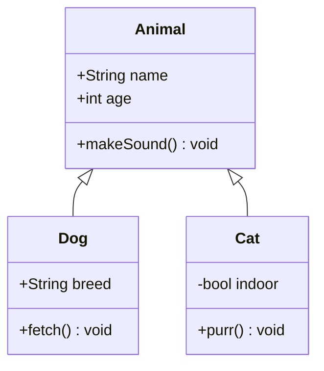

## class-all-relations

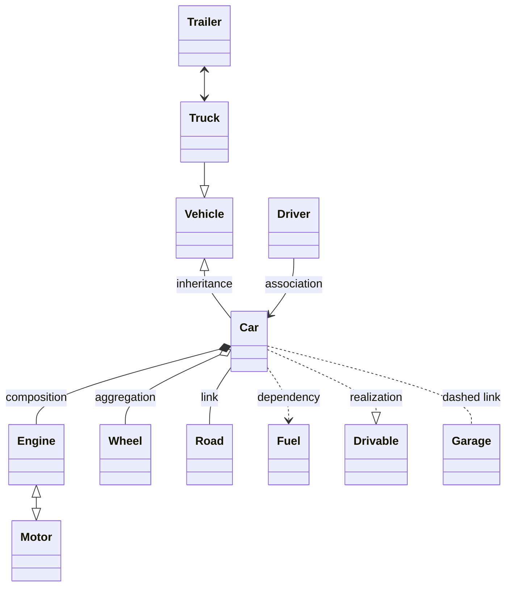

## class-cardinalities

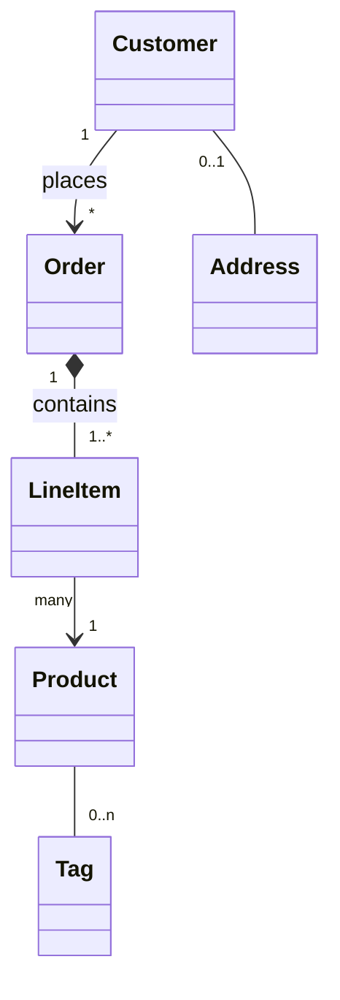

## class-generics-and-members

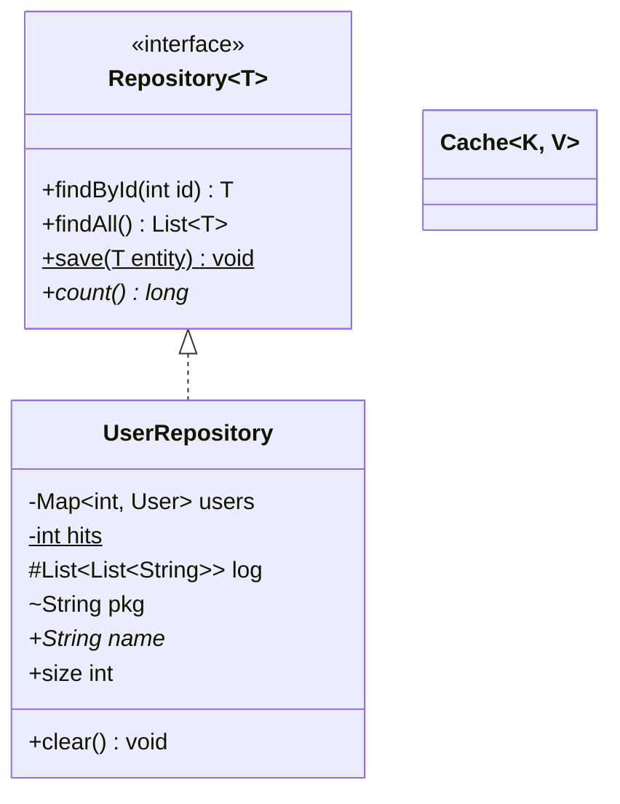

## class-annotations

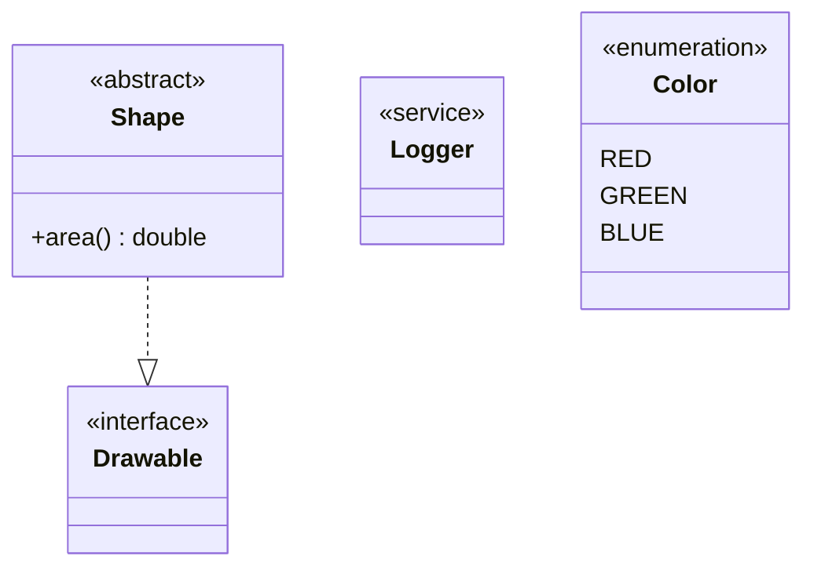

## class-namespaces

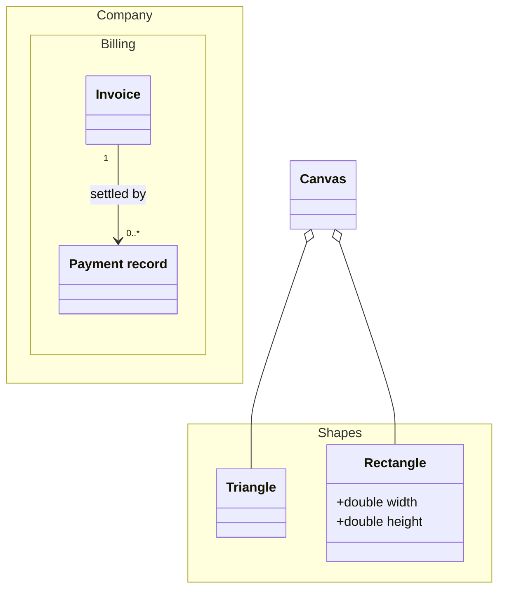

## class-notes

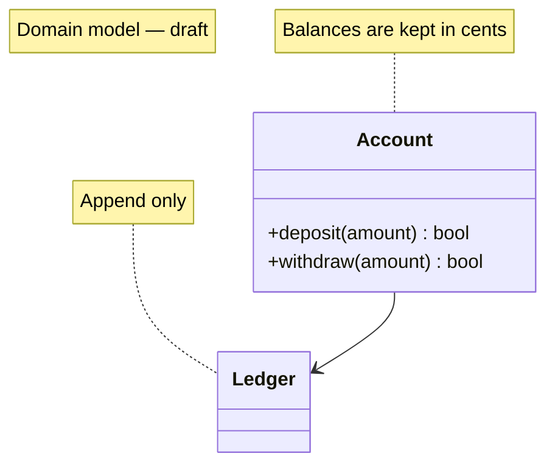

## class-labels-and-names

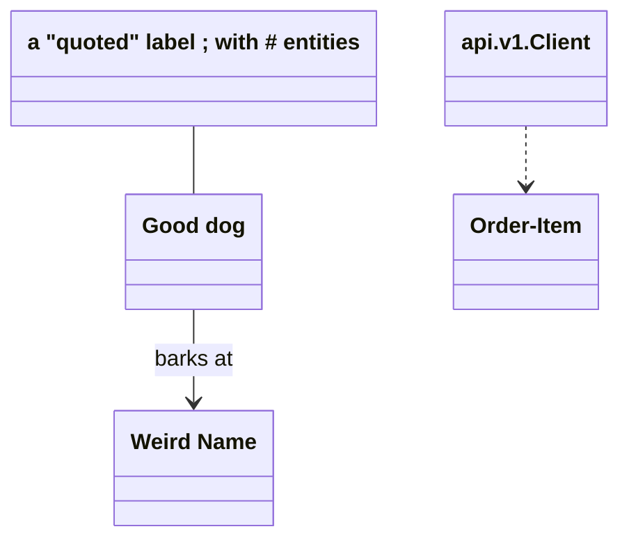

## class-styling-and-links

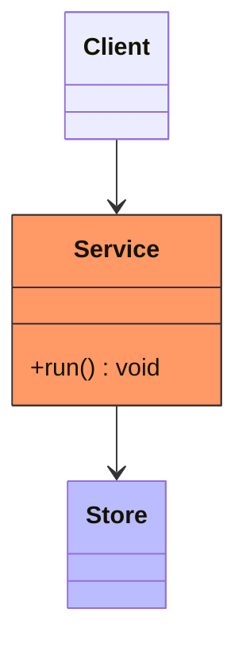

## class-direction-init

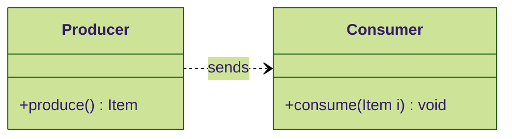

## class-frontmatter-title

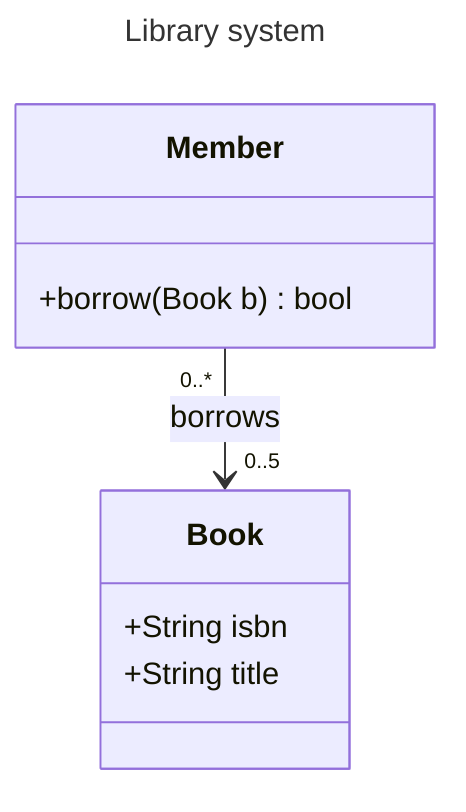

## class-lollipop

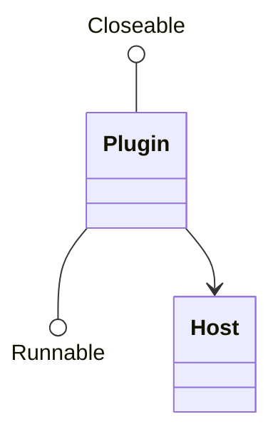

## class-member-lines-only

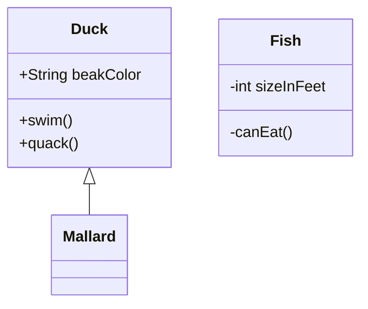

## class-empty-bodies

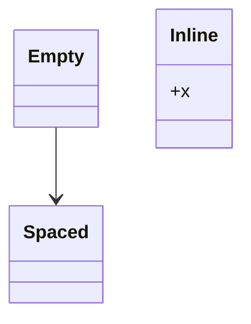

## class-mixed-forms

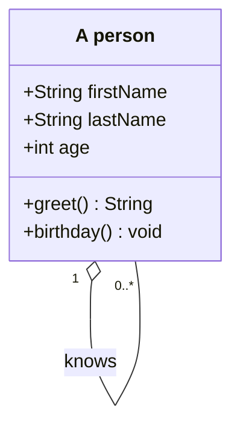

## er-shop-basic

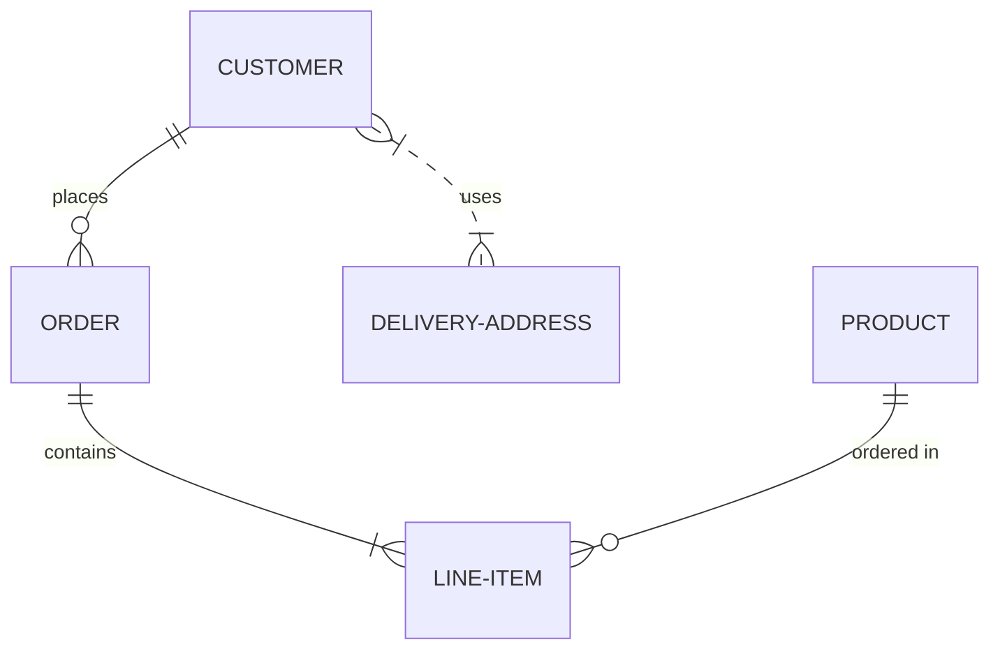

## er-attributes-keys-comments

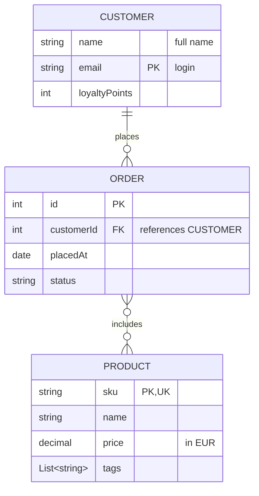

## er-aliases

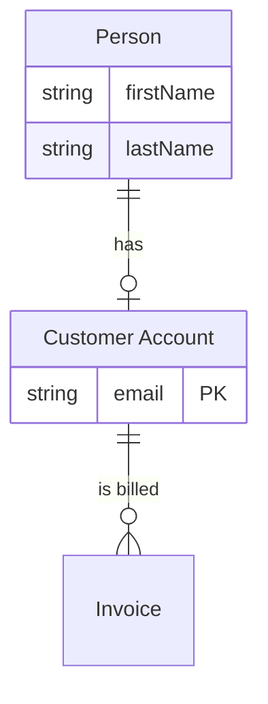

## er-word-cardinalities

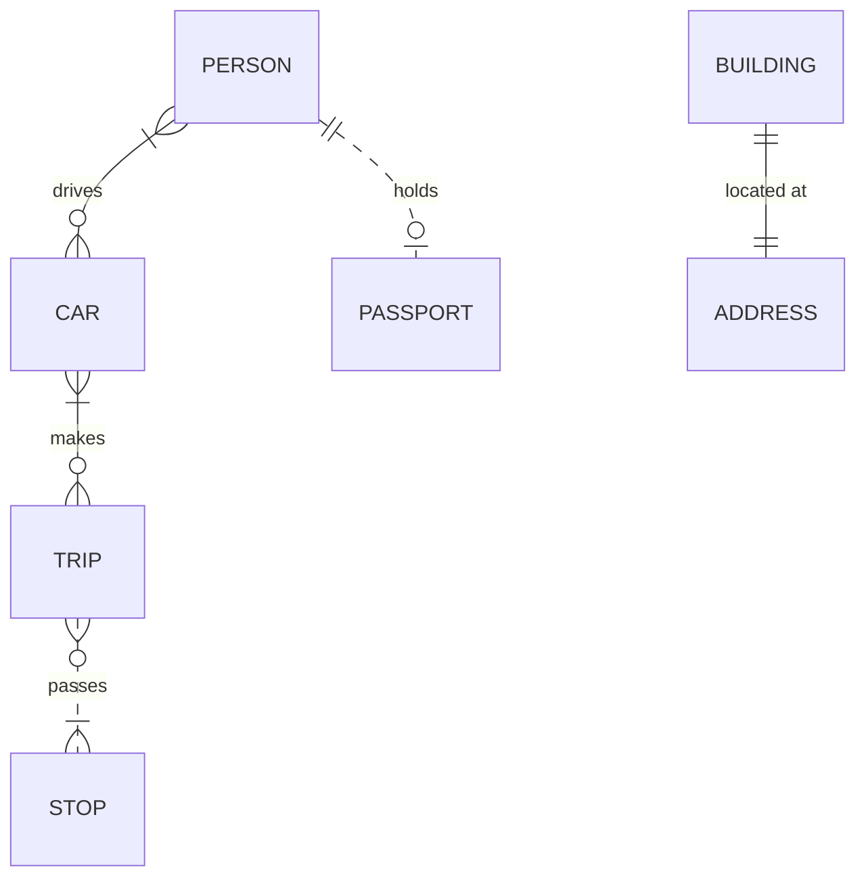

## er-all-symbols

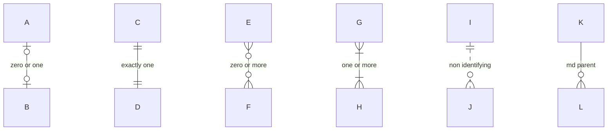

## er-direction-styling

```mermaid
%%{init: {"theme": "neutral"}}%%
erDiagram
    direction LR
    %% styling statements
    DEPARTMENT ||--|{ EMPLOYEE : employs
    EMPLOYEE {
        int id PK
        string name
    }
    DEPARTMENT:::highlight
    classDef highlight fill:#f9f,stroke:#333
    class EMPLOYEE highlight
    style DEPARTMENT fill:#bbf
```

## er-frontmatter-title

```mermaid
---
title: School
---
erDiagram
    %% students and courses
    STUDENT }o--o{ COURSE : enrolls
    COURSE {
        string code PK
        string title
        int credits
    }

    TEACHER ||--o{ COURSE : teaches
```

## er-quoted-names

```mermaid
erDiagram
    "Line Item" {
        int qty
    }
    "Order Header" ||--|{ "Line Item" : contains
    EMPTY_ENTITY
    "Order Header" {}
```

## er-self-and-duplicates

```mermaid
erDiagram
    EMPLOYEE ||--o{ EMPLOYEE : manages
    EMPLOYEE ||--|| DESK : uses
    EMPLOYEE ||--|| DESK : uses
    EMPLOYEE {
        string(10) code
        varchar[64] name
        *int star
    }
```
