# Flowchart corpus (round 2)

Flowchart syntax beyond the round-1 subset: legacy `graph`, subgraphs, styling, groups, every shape and link kind, markdown strings, frontmatter.

## fc2-graph-semicolons

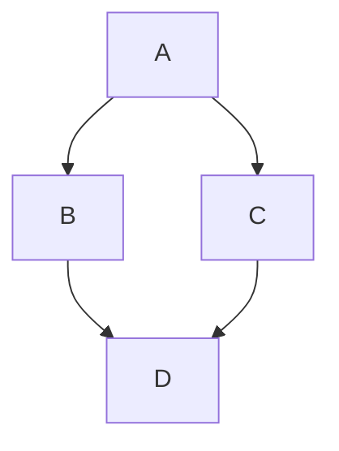

## fc2-graph-no-direction

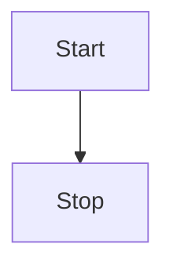

## fc2-ampersand-groups

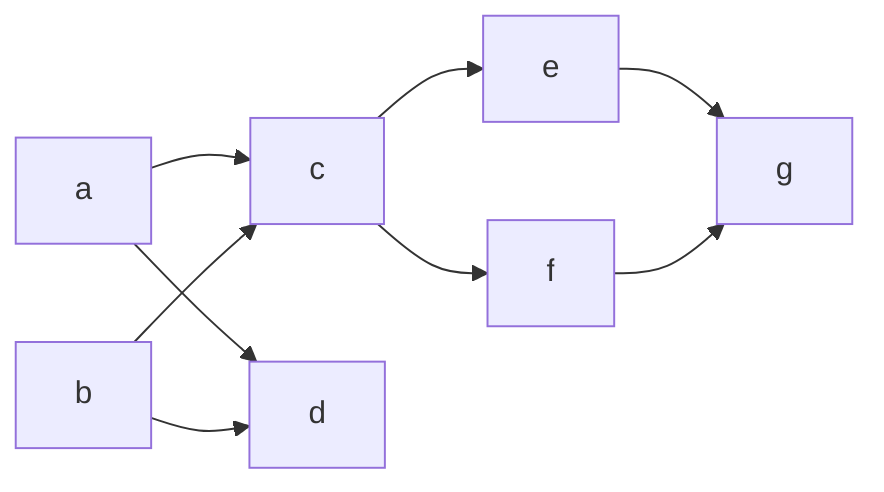

## fc2-every-shape

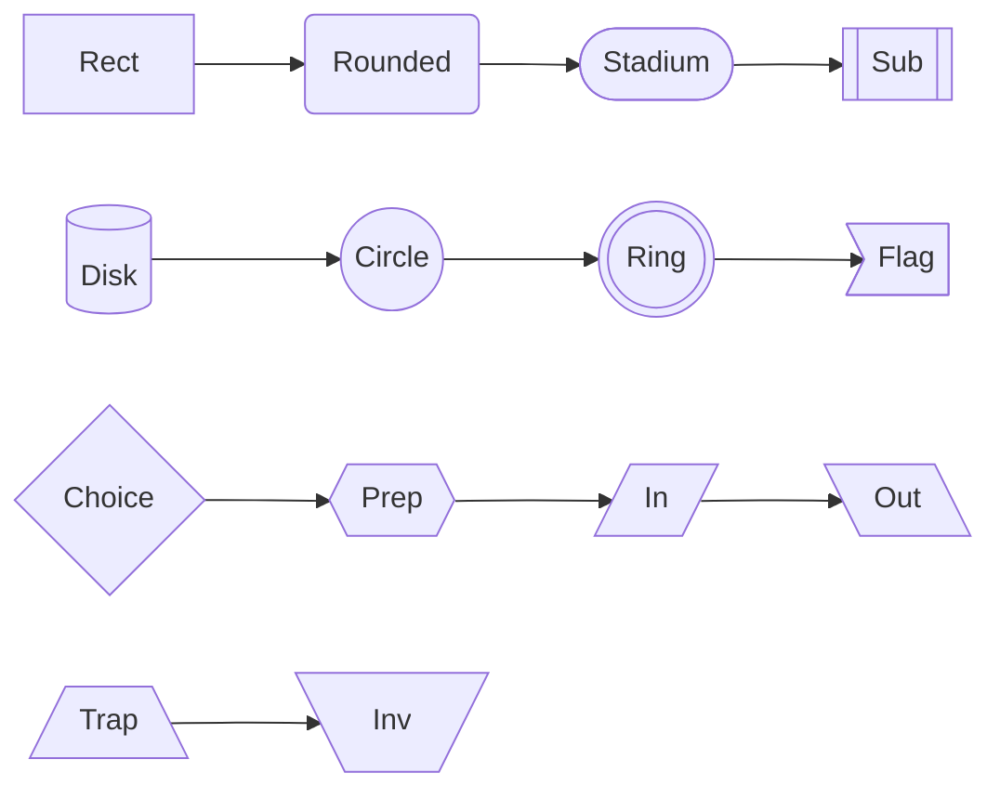

## fc2-every-link

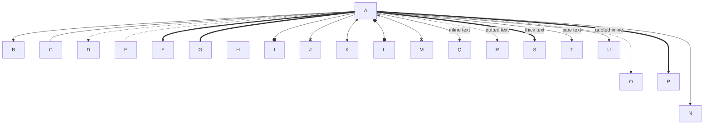

## fc2-subgraph-forms

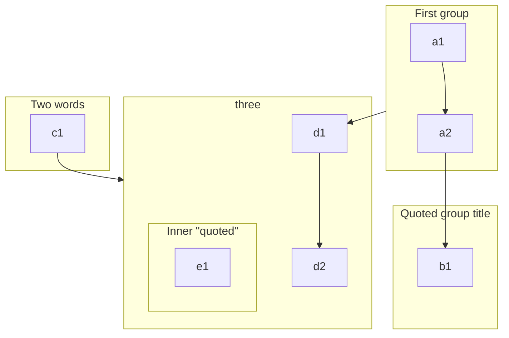

## fc2-styling-everything

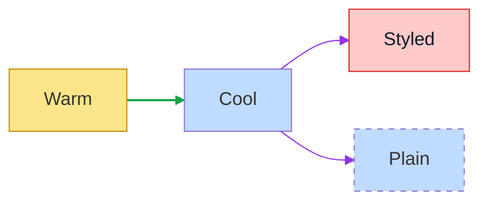

## fc2-markdown-labels

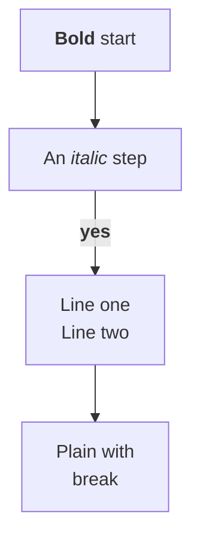

## fc2-frontmatter-title

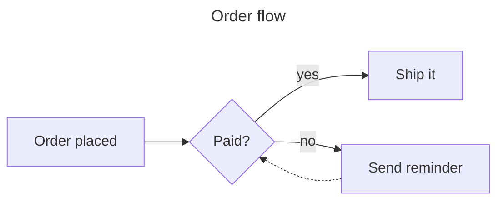

## fc2-attr-shapes

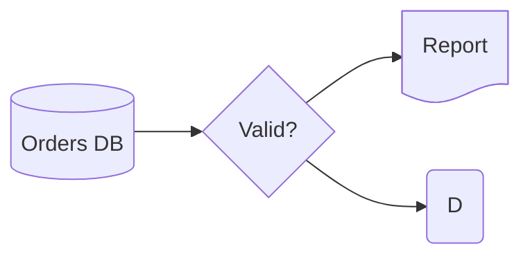

## fc2-edge-ids

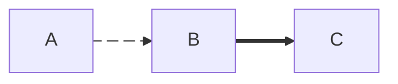

## fc2-odd-ids

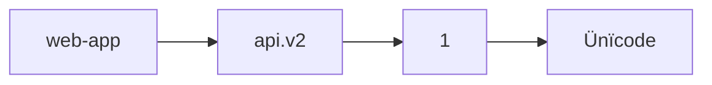

## fc2-init-elk-like

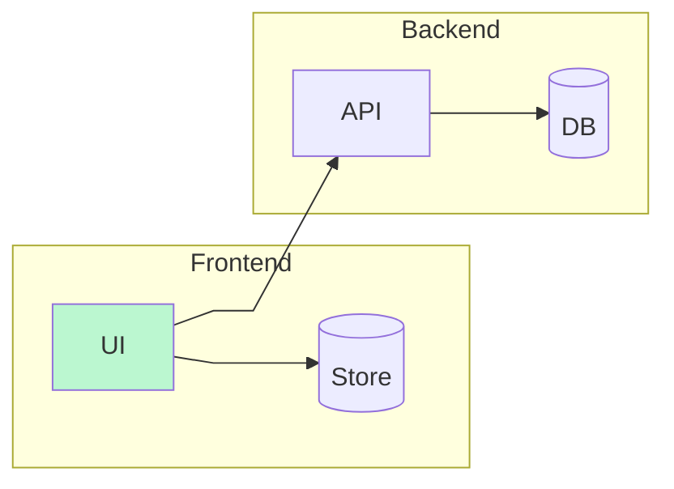
