# Kanban corpus

Extra kanban examples for the kanban parser / edit engine tests
(tests/unit/editor/mermaid-kanban-*.test.ts). Same format as
mermaid-corpus.md: `## heading` then a mermaid fence.

## kb-docs-example

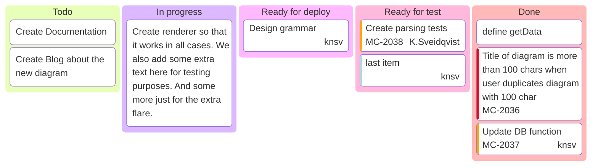

## kb-block-metadata

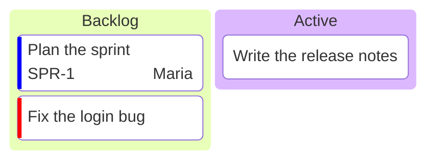

## kb-bare-cards

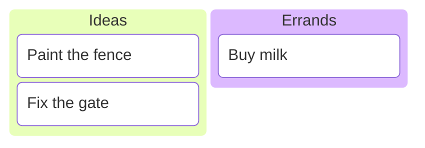

## kb-comments-init

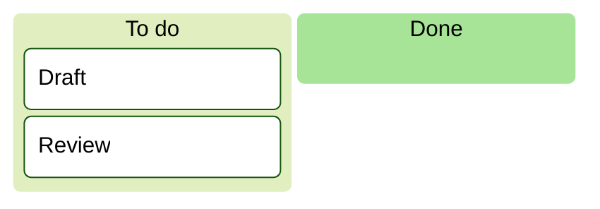

## kb-frontmatter

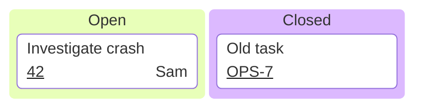

## kb-tabs

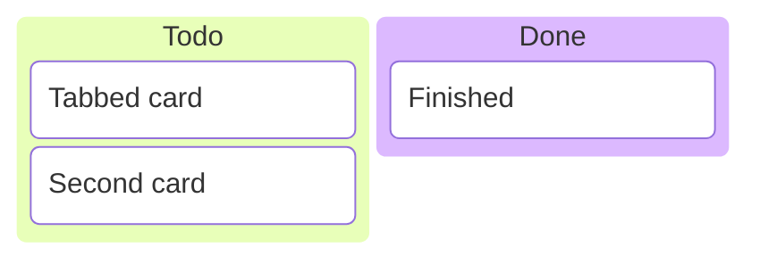

## kb-icons-classes

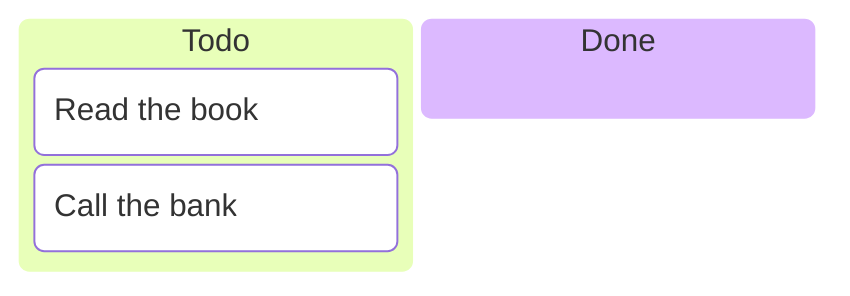

## kb-markdown-strings

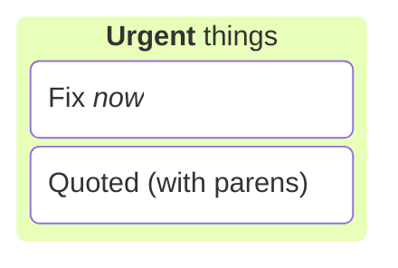

## kb-empty-columns

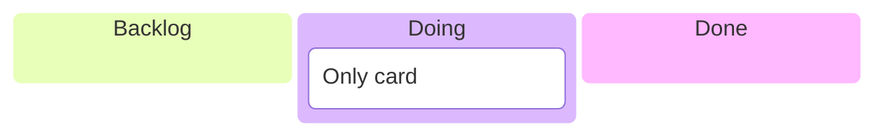

## kb-odd-indent

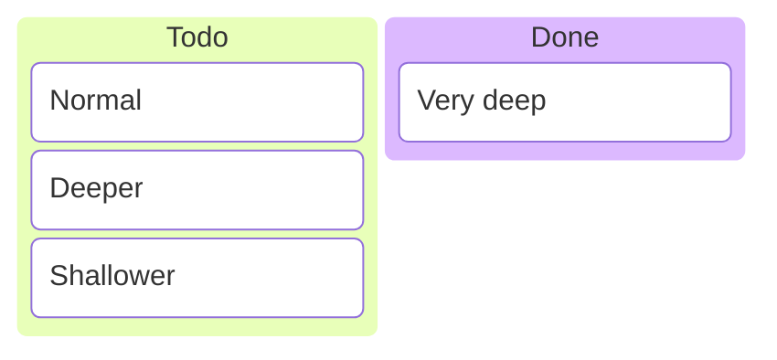

## kb-meta-label-and-numbers

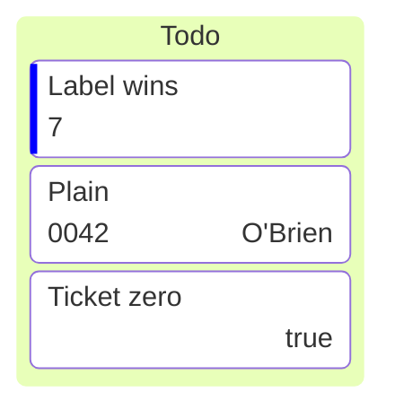
