# Mindmap corpus

Extra mindmap examples for the mindmap parser / edit engine tests
(tests/unit/editor/mermaid-mindmap-*.test.ts). Same format as
mermaid-corpus.md: `## heading` then a mermaid fence.

## mm-all-shapes

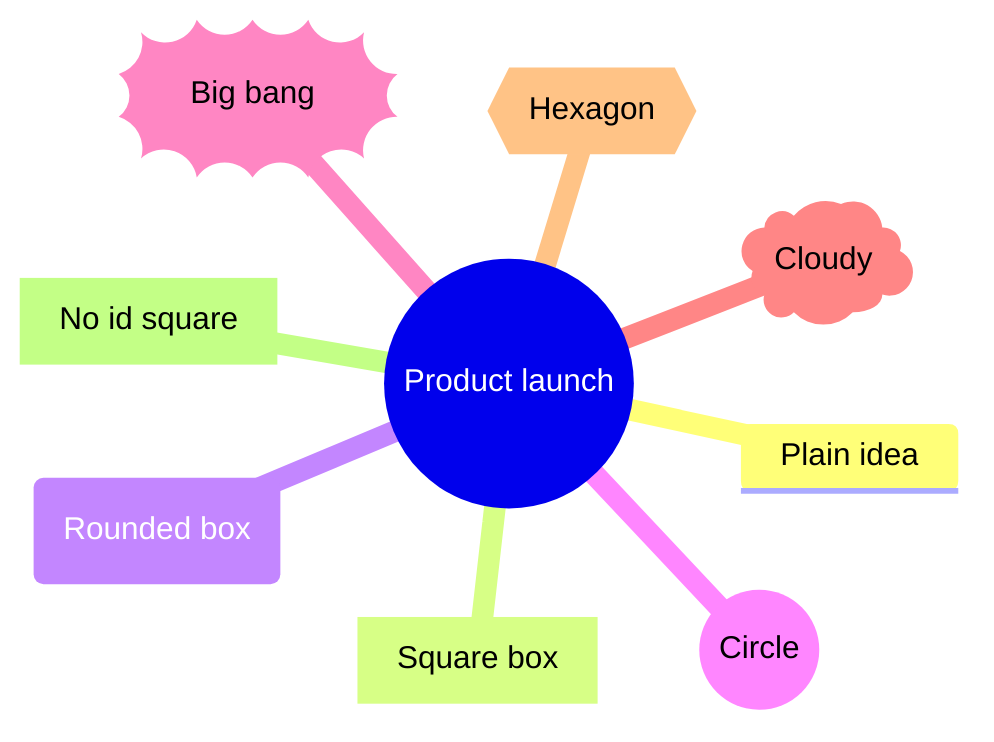

## mm-icons-classes

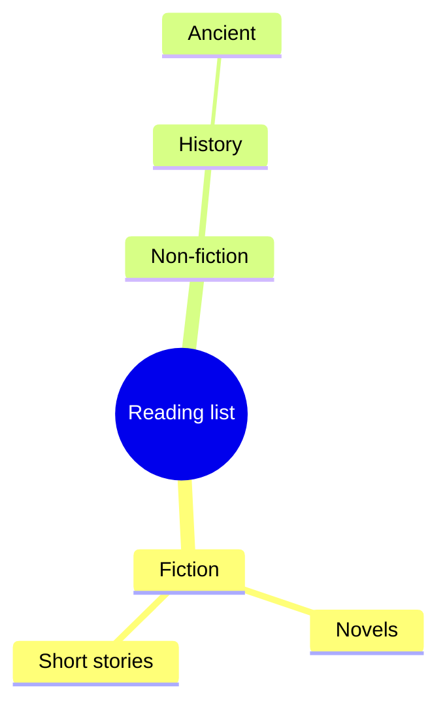

## mm-deep-tree

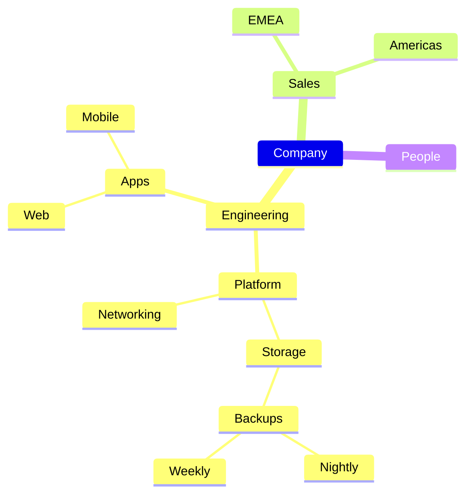

## mm-markdown-strings

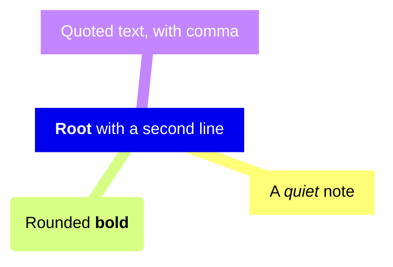

## mm-comments

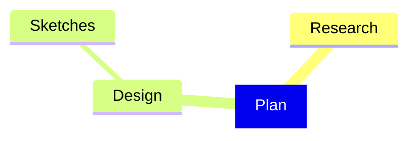

## mm-init-directive

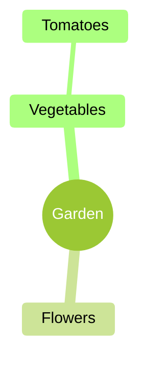

## mm-frontmatter-title

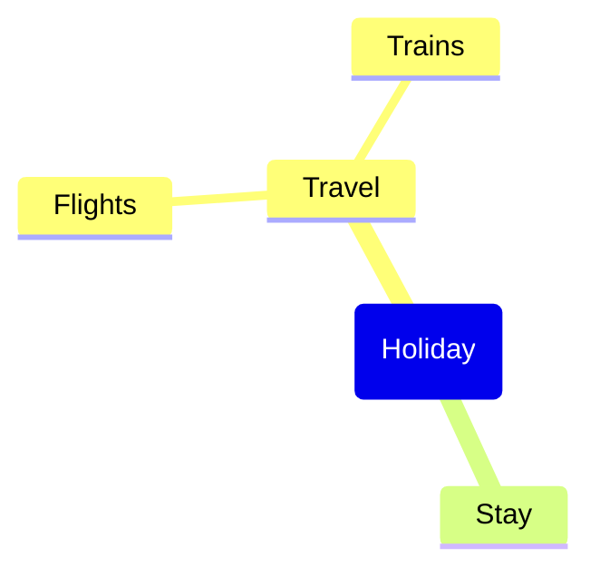

## mm-tabs

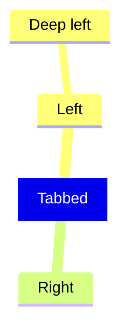

## mm-four-spaces

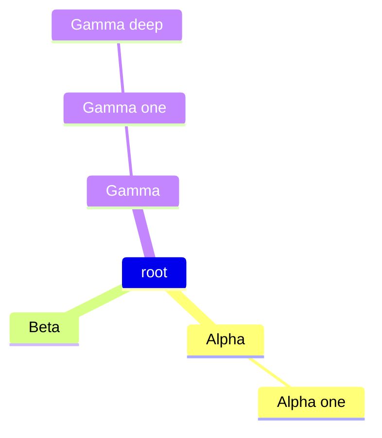

## mm-inconsistent-indent

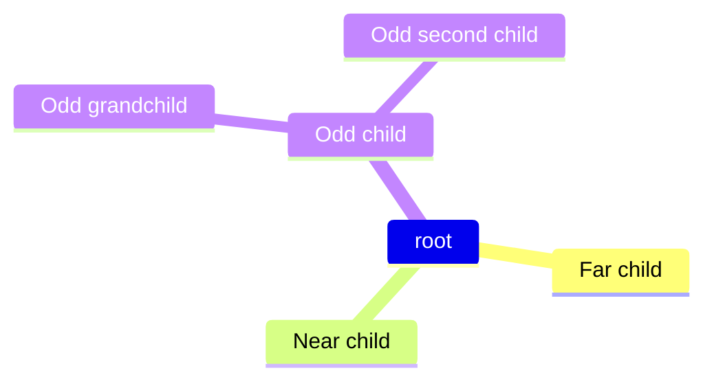

## mm-multiline-and-tail-comments

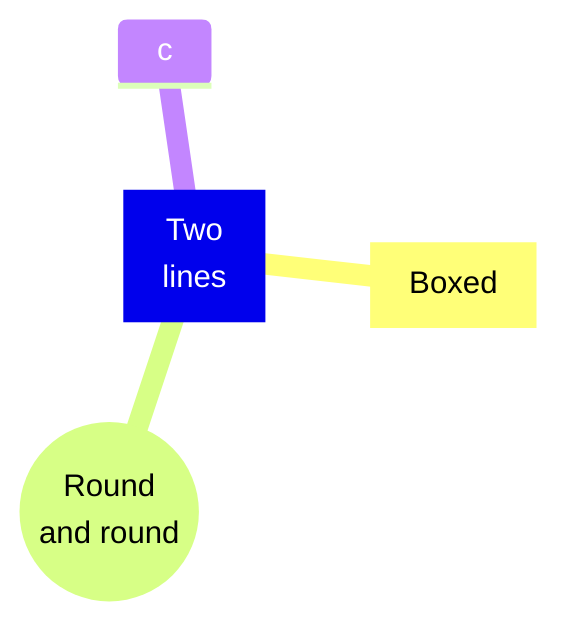

## mm-entities

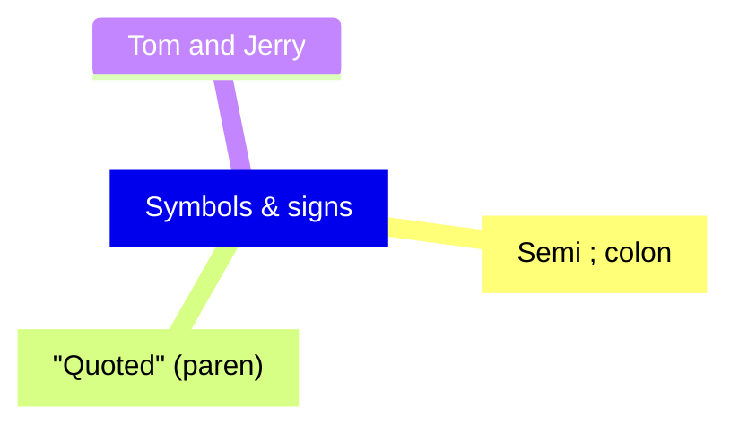
