# Mermaid corpus: pie, gantt, timeline

Realistic pie / gantt / timeline diagrams for the parser oracle, the
edit property tests and the svg mapping tests. Same format as
mermaid-corpus.md: an H2 heading, then one mermaid fence.

## pie-basic

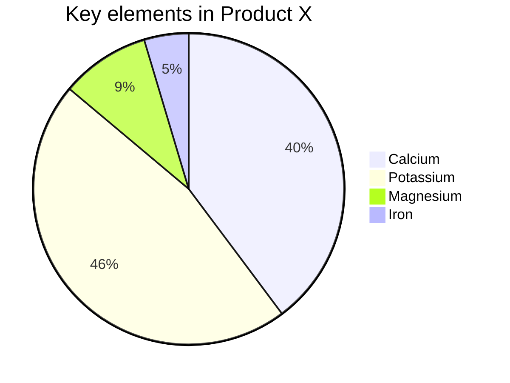

## pie-frontmatter-init

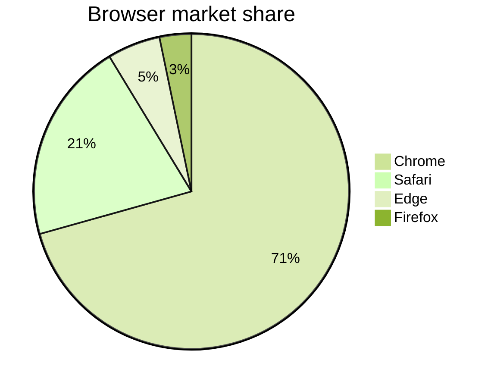

## pie-comments-showdata

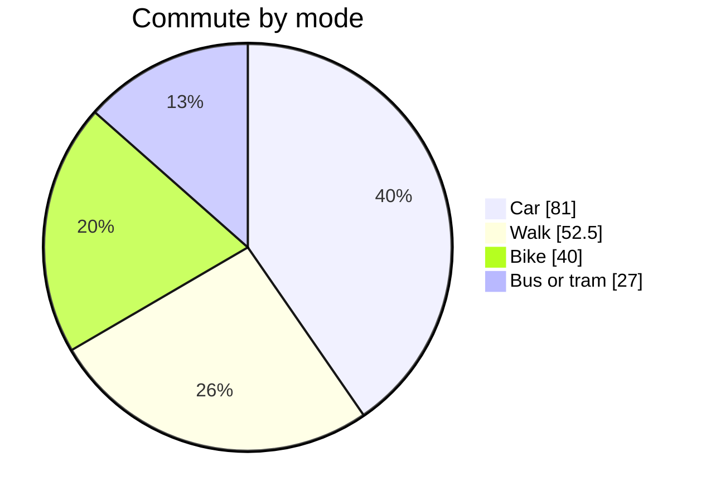

## pie-inline-title

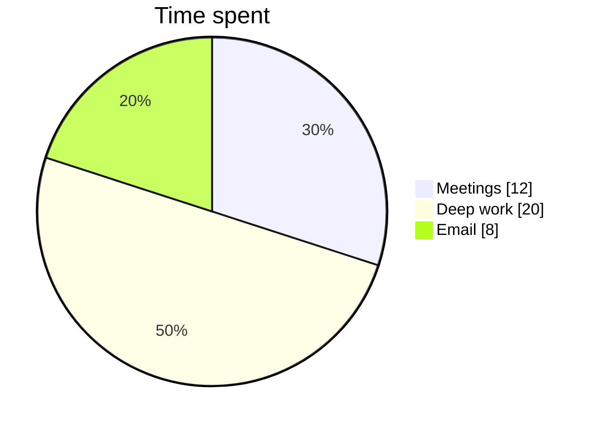

## pie-entities-escapes

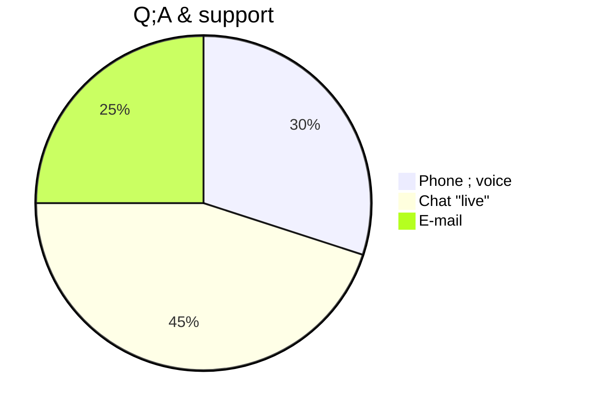

## pie-duplicate-labels

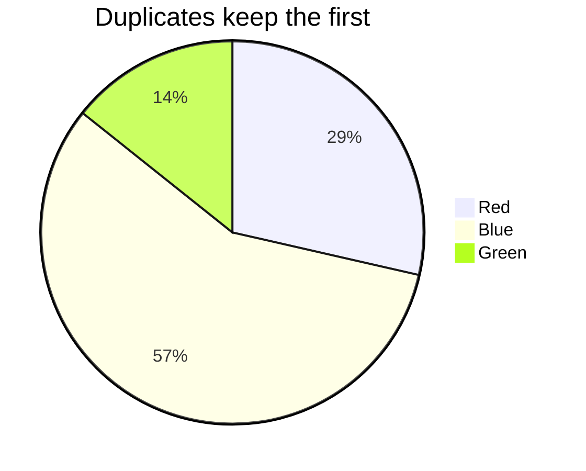

## pie-tiny-slice

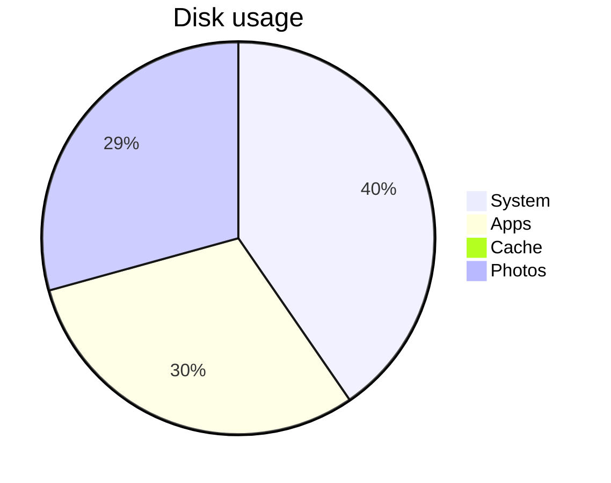

## gantt-basic

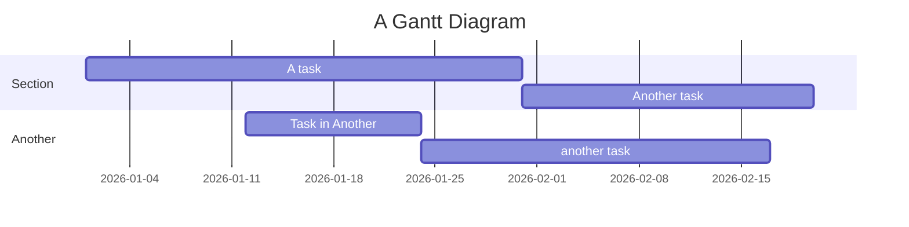

## gantt-status-flags

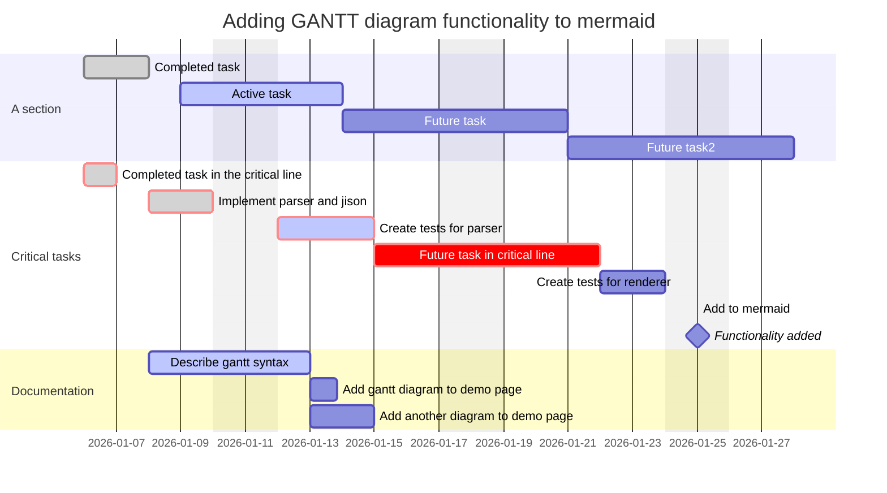

## gantt-frontmatter-compact

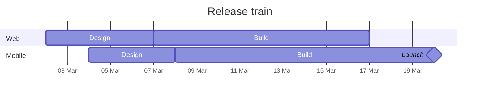

## gantt-day-month-year

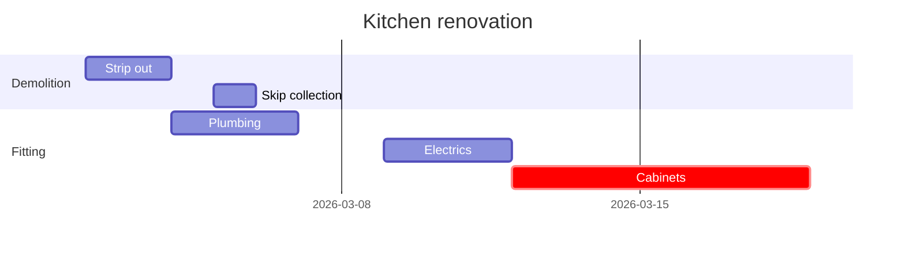

## gantt-hours

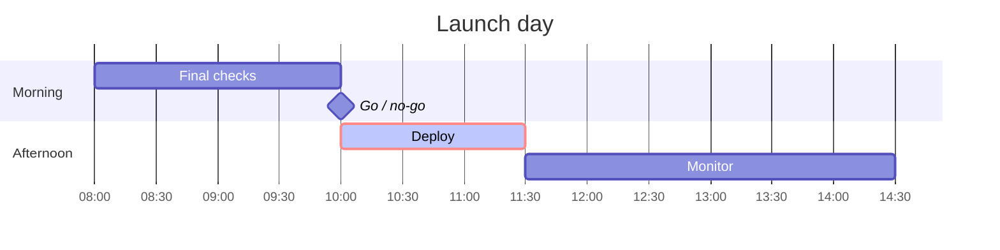

## gantt-until-click-vert

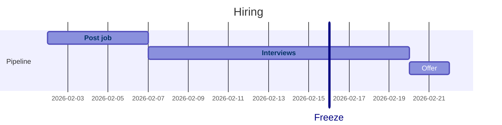

## gantt-no-sections

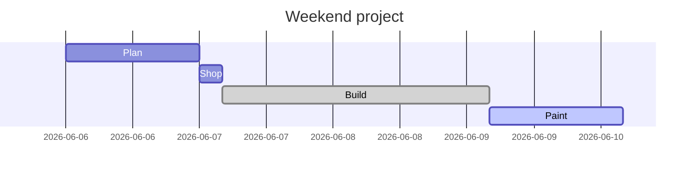

## gantt-comments-settings

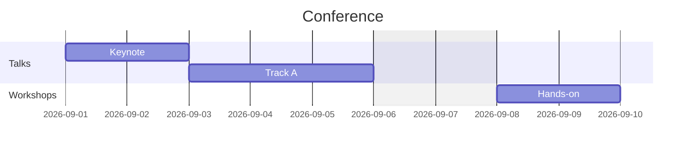

## timeline-basic

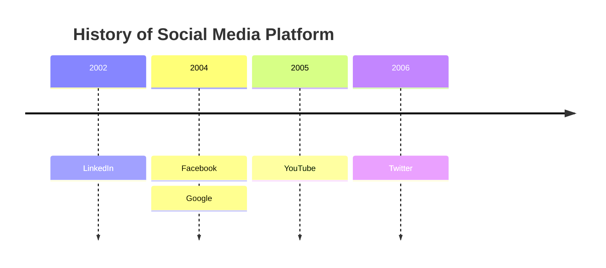

## timeline-sections

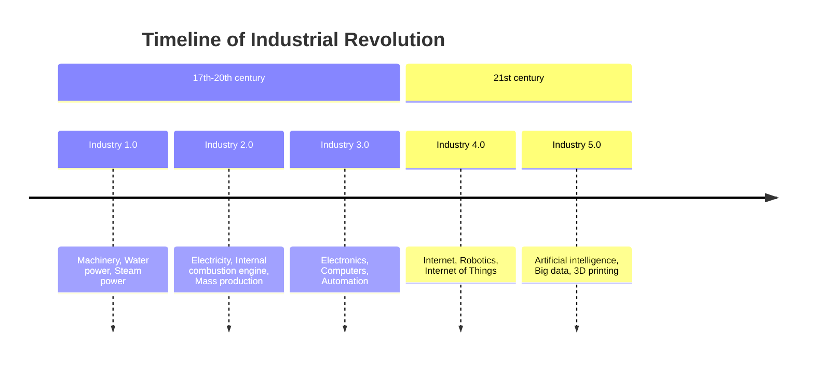

## timeline-multi-events

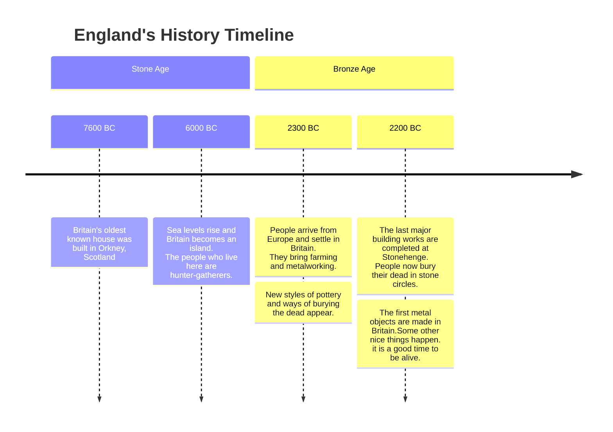

## timeline-frontmatter-init

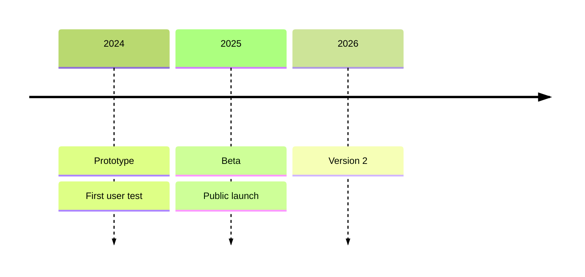

## timeline-comments-entities

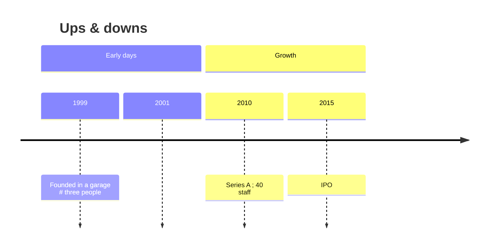

## timeline-td

```mermaid
timeline TD
    title Course plan
    Week 1 : Basics : Setup
    Week 2 : Variables
    Week 3 : Functions
```
