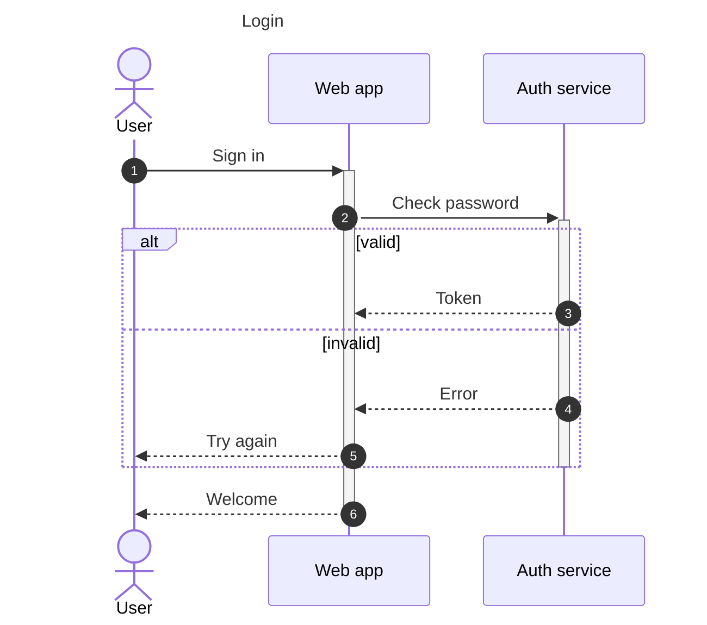
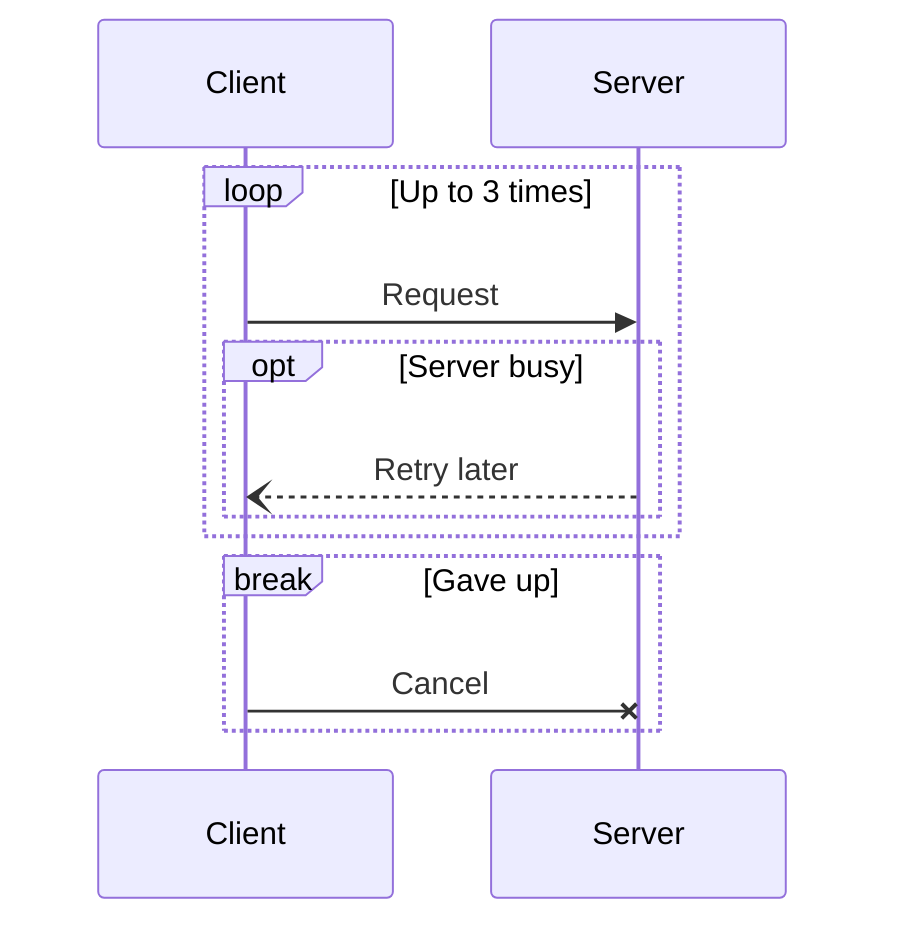
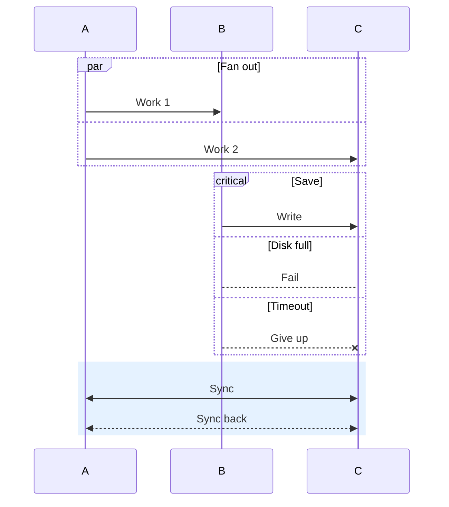
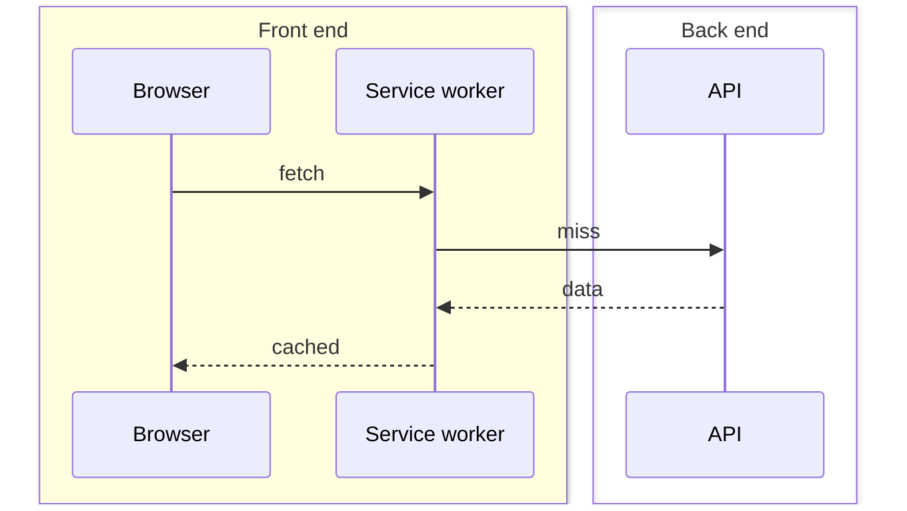
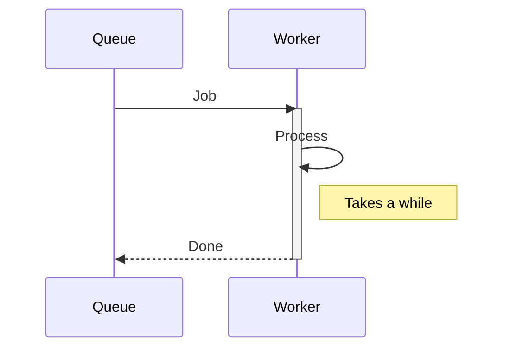
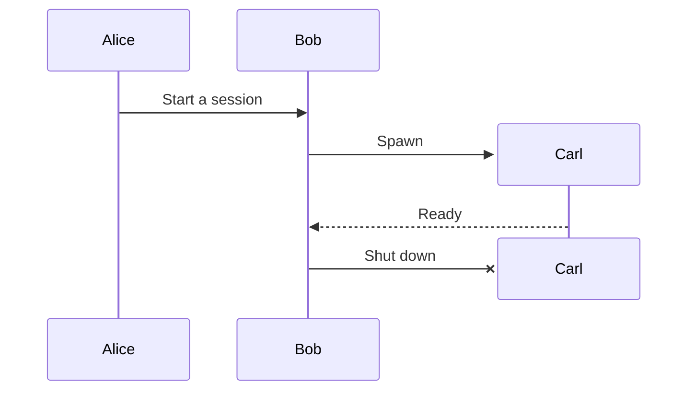
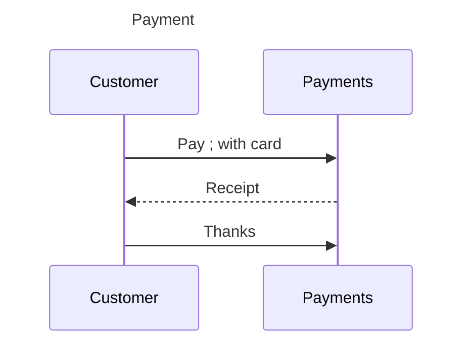

# Sequence corpus (round 2)

Sequence syntax beyond the round-1 subset: actors, activations, blocks, autonumber, boxes, every arrow, create / destroy, titles.

## seq2-login

## seq2-nested-blocks

## seq2-par-critical

## seq2-boxes

## seq2-activate-explicit

## seq2-create-destroy

## seq2-frontmatter-comments

