# State diagram corpus

Realistic state diagrams for the state parser / edit engine / SVG
mapping tests. Format: `## heading` then a mermaid fence.

## state-v1-basic

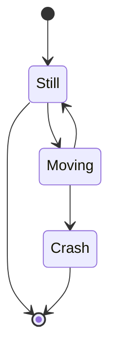

## state-descriptions

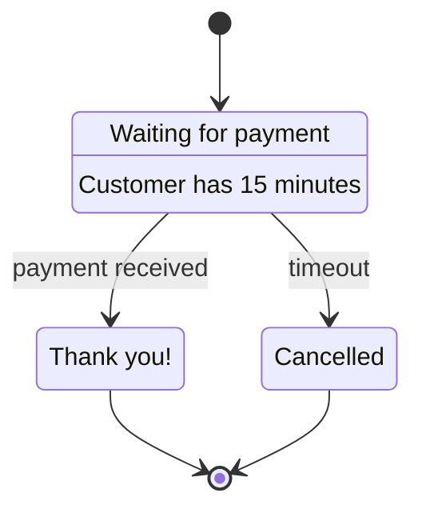

## state-composite-nested

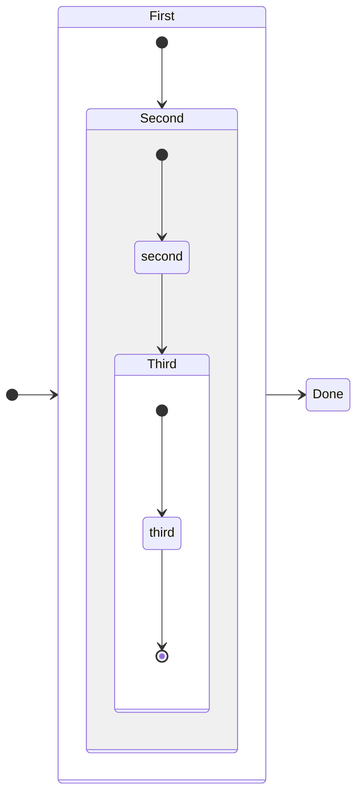

## state-concurrency

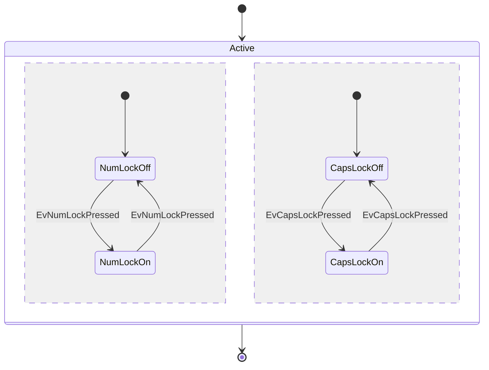

## state-choice

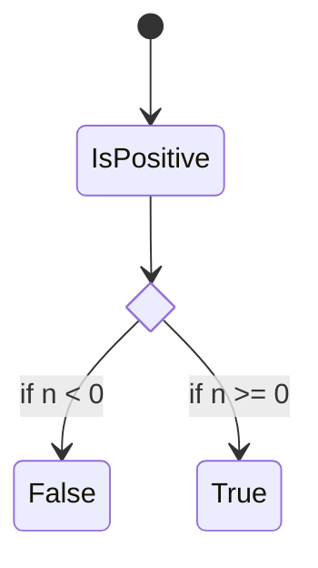

## state-fork-join

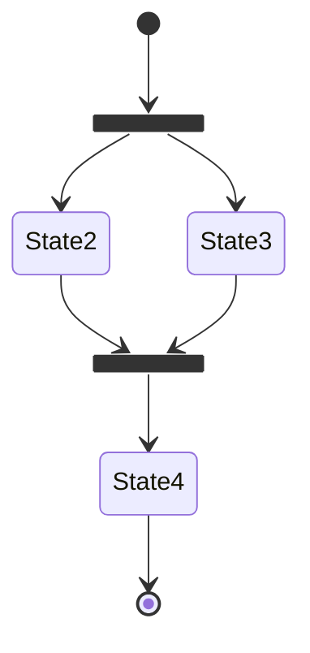

## state-notes

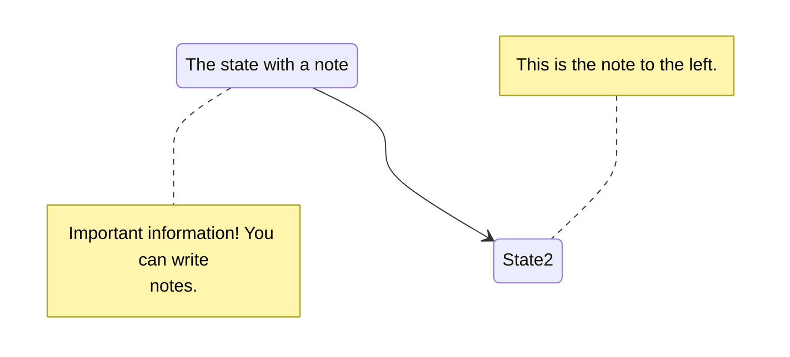

## state-comments-init

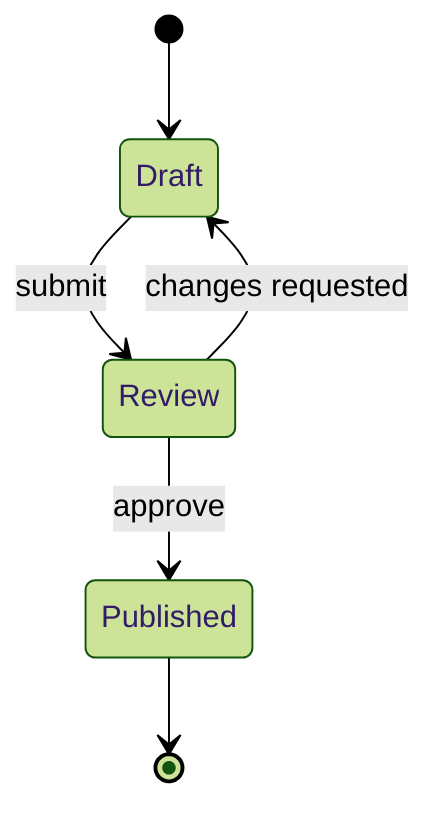

## state-frontmatter-title

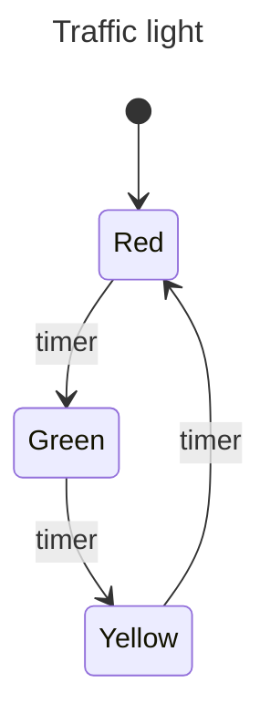

## state-styling

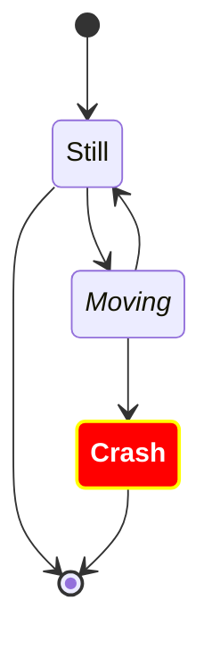

## state-v1-composite-notes

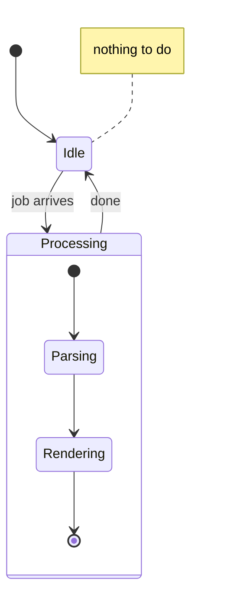

## state-composite-label-direction

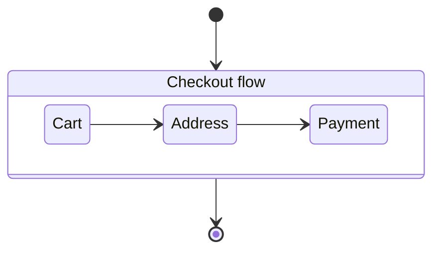

## state-entity-codes

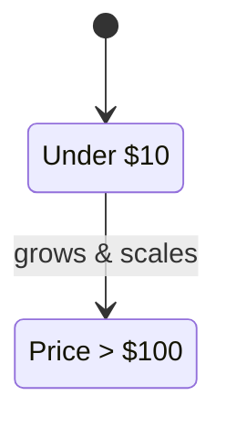

## state-duplicate-transitions

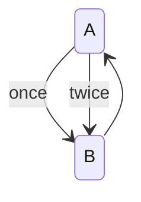

## state-choice-in-composite

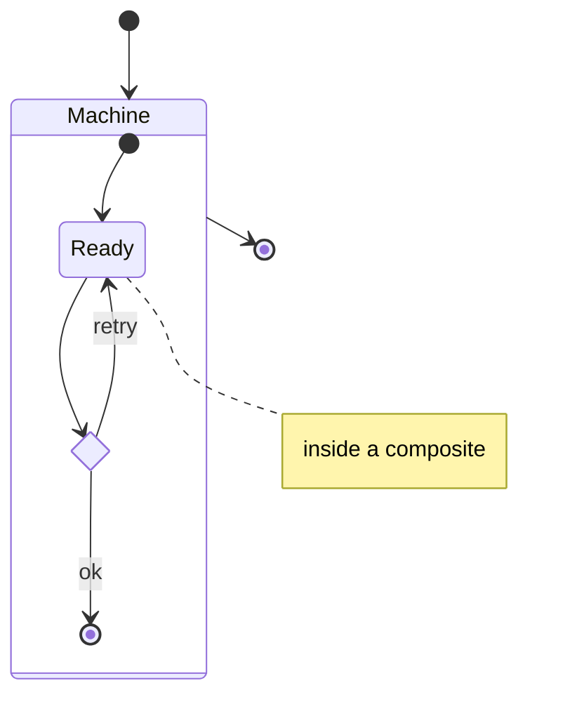

## state-compact-syntax

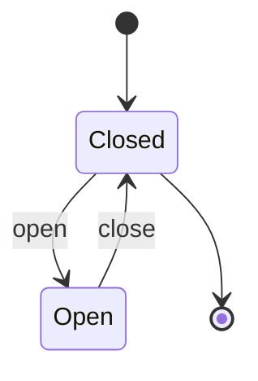
