# Mermaid Corpus

Audit corpus: one fenced mermaid block per case. Each case sits under its own H2 heading so tests can map a rendered block back to its case.

## fc-td-basic

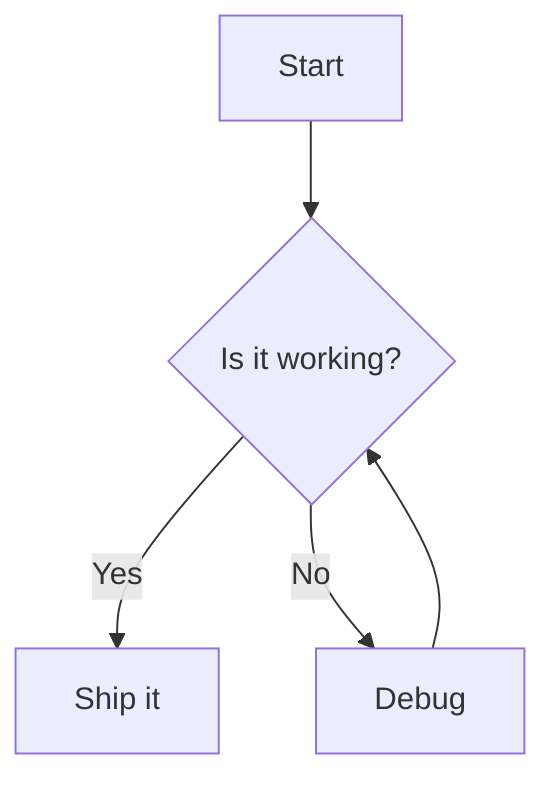

## fc-lr-basic

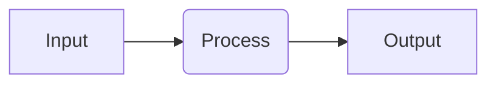

## graph-td-legacy

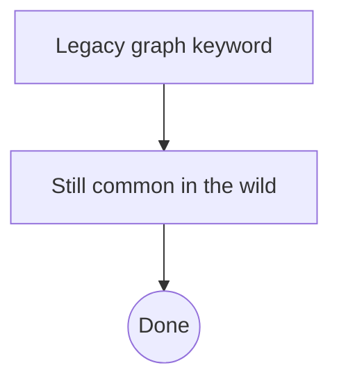

## graph-lr-legacy

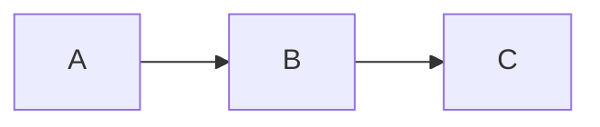

## fc-all-shapes

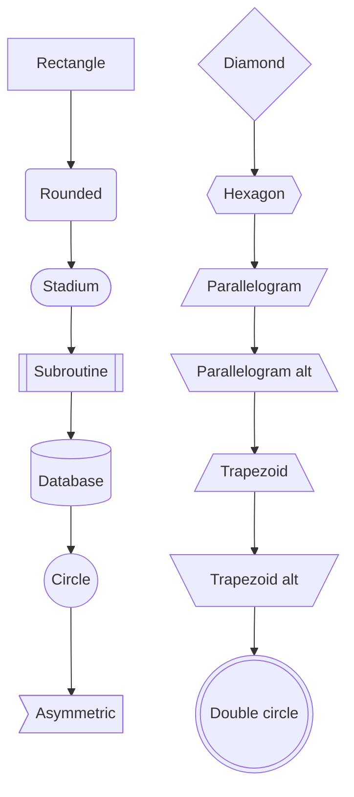

## fc-subset-shapes-editable

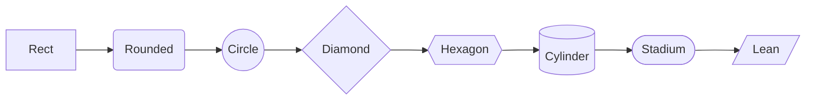

## fc-edge-types

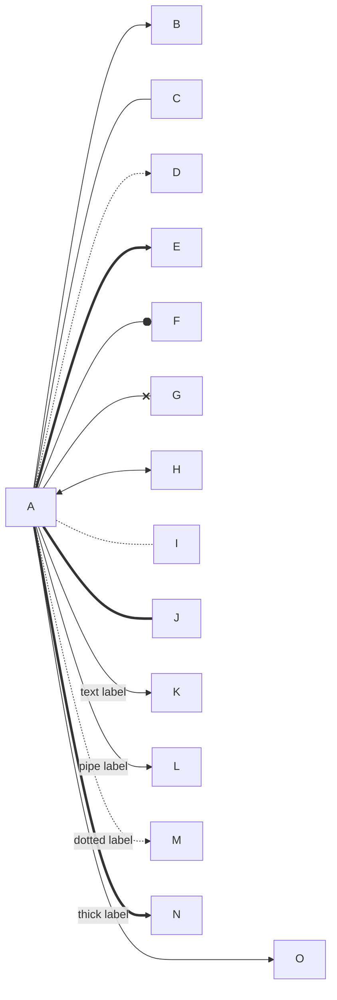

## fc-edge-subset-editable

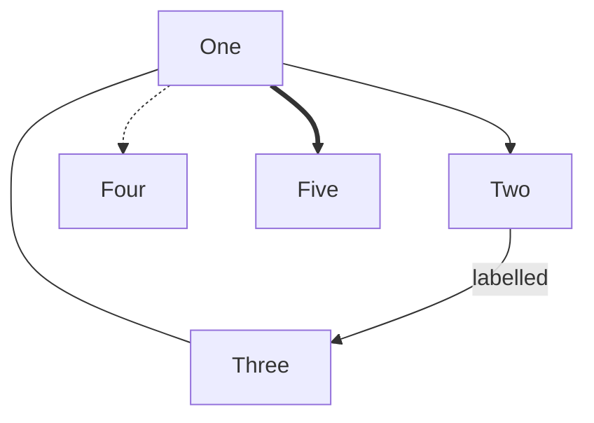

## fc-subgraphs-nested

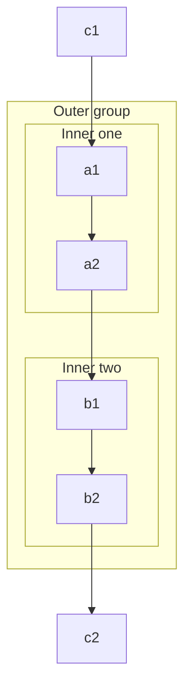

## fc-styling

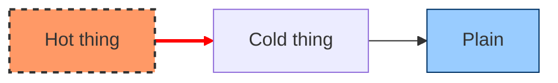

## fc-comments-ampersand-chain

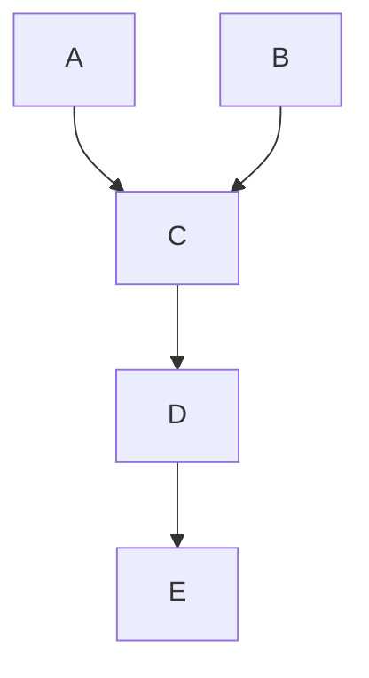

## fc-comments-only-subset

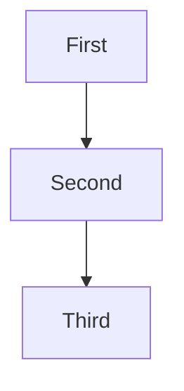

## fc-quoted-unicode-emoji

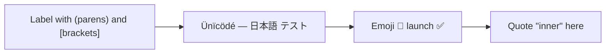

## fc-markdown-strings

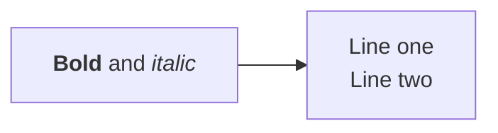

## fc-markdown-string-subset

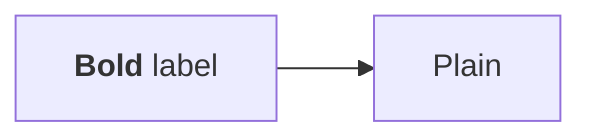

## fc-long-labels

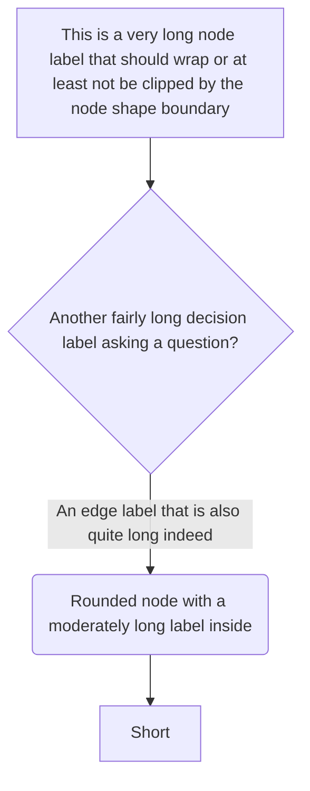

## fc-frontmatter-title

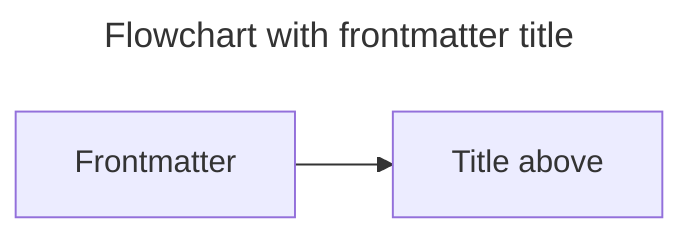

## fc-init-directive

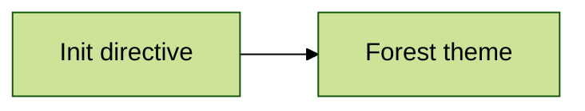

## fc-special-chars

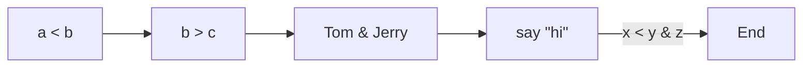

## fc-special-chars-unquoted

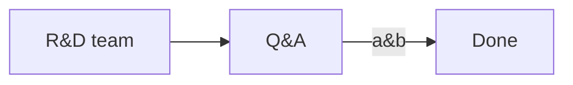

## fc-tb-direction

```mermaid
flowchart TB
    A[TB direction] --> B[Should stay TB]
```

## seq-basic

```mermaid
sequenceDiagram
    participant A as Alice
    participant B as Bob
    A->>B: Hello Bob
    B-->>A: Hi Alice
    Note over A,B: A note spanning both
```

## seq-participants-actors

```mermaid
sequenceDiagram
    actor U as User
    participant W as Web App
    participant API
    participant DB as Database
    U->>W: Click
    W->>API: Request
    API->>DB: Query
    DB-->>API: Rows
    API-->>W: JSON
    W-->>U: Render
```

## seq-arrow-types

```mermaid
sequenceDiagram
    A->B: solid no arrow
    A-->B: dotted no arrow
    A->>B: solid arrow
    A-->>B: dotted arrow
    A-xB: solid cross
    A--xB: dotted cross
    A-)B: solid async
    A--)B: dotted async
    A<<->>B: bidirectional
```

## seq-activations

```mermaid
sequenceDiagram
    Alice->>+John: Hello John
    John->>+John: Thinking
    John-->>-Alice: Hi Alice
    activate Alice
    Alice->>John: Activated explicitly
    deactivate Alice
```

## seq-notes

```mermaid
sequenceDiagram
    participant A
    participant B
    Note left of A: Left note
    Note right of B: Right note
    Note over A: Over A
    Note over A,B: Over both
    A->>B: Message
```

## seq-blocks

```mermaid
sequenceDiagram
    autonumber
    participant C as Client
    participant S as Server
    loop Every minute
        C->>S: Heartbeat
    end
    alt success
        S-->>C: 200 OK
    else failure
        S-->>C: 500 Error
    end
    opt Optional step
        C->>S: Extra
    end
    par Parallel A
        C->>S: Task A
    and Parallel B
        C->>S: Task B
    end
    critical Must happen
        C->>S: Commit
    option Timeout
        C->>S: Rollback
    end
    break When cancelled
        C->>S: Abort
    end
    rect rgb(200, 220, 255)
        C->>S: Highlighted
    end
```

## seq-box

```mermaid
sequenceDiagram
    box Purple Frontend
    participant A as Browser
    participant B as CDN
    end
    box Backend
    participant C as API
    end
    A->>B: GET
    B->>C: Miss
```

## seq-comment-subset

```mermaid
sequenceDiagram
    %% comment inside an editable sequence
    participant A as Alice
    participant B as Bob
    A->>B: Map x->y and back
    B-->>A: Done
```

## seq-arrow-in-text

```mermaid
sequenceDiagram
    participant A
    participant B
    A->>B: Convert a->b first
    B-->>A: Ack
```

## seq-special-chars

```mermaid
sequenceDiagram
    participant A as Client <web>
    participant B as R&D "Server"
    A->>B: if a < b && c > d
    B-->>A: OK & done
```

## class-diagram

```mermaid
classDiagram
    class Animal {
        +String name
        +int age
        +makeSound() void
    }
    class Dog {
        +fetch() void
    }
    class Cat
    Animal <|-- Dog
    Animal <|-- Cat
    Dog "1" --> "*" Bone : chews
    class Shape {
        <<interface>>
        +area() double
    }
```

## state-diagram

```mermaid
stateDiagram-v2
    [*] --> Idle
    Idle --> Running : start
    Running --> Paused : pause
    Paused --> Running : resume
    Running --> Done : finish
    state Running {
        [*] --> Loading
        Loading --> Working
        Working --> [*]
    }
    state fork_state <<fork>>
    Done --> fork_state
    fork_state --> Archive
    fork_state --> Notify
    state join_state <<join>>
    Archive --> join_state
    Notify --> join_state
    join_state --> [*]
    note right of Idle : Waiting for input
```

## er-diagram

```mermaid
erDiagram
    CUSTOMER ||--o{ ORDER : places
    ORDER ||--|{ LINE_ITEM : contains
    CUSTOMER {
        string name
        string email PK
    }
    ORDER {
        int id PK
        date created
    }
```

## gantt

```mermaid
gantt
    title Project plan
    dateFormat YYYY-MM-DD
    section Design
    Research      :a1, 2026-01-01, 10d
    Wireframes    :after a1, 7d
    section Build
    Implementation :2026-01-20, 20d
    Testing        :crit, 2026-02-10, 5d
```

## pie

```mermaid
pie showData
    title Pets adopted
    "Dogs" : 386
    "Cats" : 85
    "Rats" : 15
```

## journey

```mermaid
journey
    title My working day
    section Go to work
      Make tea: 5: Me
      Go upstairs: 3: Me
    section Work
      Do work: 1: Me, Cat
```

## gitgraph

```mermaid
gitGraph
    commit
    branch develop
    checkout develop
    commit
    commit
    checkout main
    merge develop
    commit
```

## mindmap

```mermaid
mindmap
  root((Mindmap))
    Origins
      Long history
      Popularisation
    Research
      On effectiveness
      On automatic creation
    Tools
      Pen and paper
      Mermaid
```

## timeline

```mermaid
timeline
    title History of social media
    2002 : LinkedIn
    2004 : Facebook : Google
    2005 : YouTube
    2006 : Twitter
```

## quadrant

```mermaid
quadrantChart
    title Reach and engagement
    x-axis Low Reach --> High Reach
    y-axis Low Engagement --> High Engagement
    quadrant-1 Expand
    quadrant-2 Promote
    quadrant-3 Re-evaluate
    quadrant-4 Improve
    Campaign A: [0.3, 0.6]
    Campaign B: [0.45, 0.23]
    Campaign C: [0.57, 0.69]
```

## sankey

```mermaid
sankey-beta
Agricultural waste,Bio-conversion,124.729
Bio-conversion,Liquid,0.597
Bio-conversion,Losses,26.862
Bio-conversion,Solid,280.322
```

## xychart

```mermaid
xychart-beta
    title "Sales Revenue"
    x-axis [jan, feb, mar, apr, may]
    y-axis "Revenue (in $)" 4000 --> 11000
    bar [5000, 6000, 7500, 8200, 9500]
    line [5000, 6000, 7500, 8200, 9500]
```

## block

```mermaid
block-beta
  columns 3
  a["Block A"] b["Block B"] c["Block C"]
  d["Wide block"]:3
```

## c4-context

```mermaid
C4Context
  title System Context diagram
  Person(customer, "Customer", "A customer of the bank")
  System(banking, "Internet Banking", "Lets customers view accounts")
  System_Ext(mail, "E-mail system", "Microsoft Exchange")
  Rel(customer, banking, "Uses")
  Rel(banking, mail, "Sends e-mail", "SMTP")
```

## requirement

```mermaid
requirementDiagram
    requirement test_req {
    id: 1
    text: the test text.
    risk: high
    verifymethod: test
    }
    element test_entity {
    type: simulation
    }
    test_entity - satisfies -> test_req
```

## architecture

```mermaid
architecture-beta
    group api(cloud)[API]
    service db(database)[Database] in api
    service server(server)[Server] in api
    db:L -- R:server
```

## kanban

```mermaid
kanban
  Todo
    [Write corpus]
    [Run audit]
  Doing
    [Review findings]
  Done
    [Setup]
```

## packet

```mermaid
packet-beta
    0-15: "Source Port"
    16-31: "Destination Port"
    32-63: "Sequence Number"
```

## radar

```mermaid
radar-beta
    title Skills
    axis a["Speed"], b["Power"], c["Range"]
    curve x["Player"]{4, 3, 5}
    max 5
```

## invalid-diagram

```mermaid
flowchart TD
    A[Unclosed --> B
    this is not ((valid
```

## invalid-unknown-type

```mermaid
notARealDiagram
    foo --> bar
```

## mixed-capital-M

```Mermaid
flowchart LR
    A[Capital M fence] --> B
```

## mixed-info-string

```mermaid title="extra info"
flowchart LR
    A[Extra info string] --> B
```

## mixed-tilde-fence

~~~mermaid
flowchart LR
    A[Tilde fence] --> B
~~~

## mixed-in-list

- A list item with a diagram:

  ```mermaid
  flowchart LR
      A[In a list] --> B[Item]
  ```

- Second item.

## mixed-in-blockquote

> A quote with a diagram:
>
> ```mermaid
> flowchart LR
>     A[In a quote] --> B[Block]
> ```

## mixed-plain-code

```js
// A normal code fence between diagrams.
const x = 1 < 2 && 3 > 2;
```

## trailing-paragraph

The last paragraph of the corpus. EDIT_TARGET_SENTENCE.
